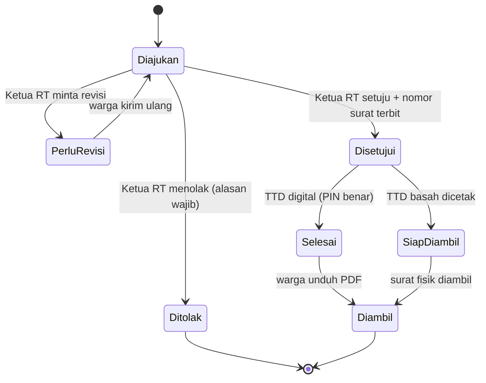
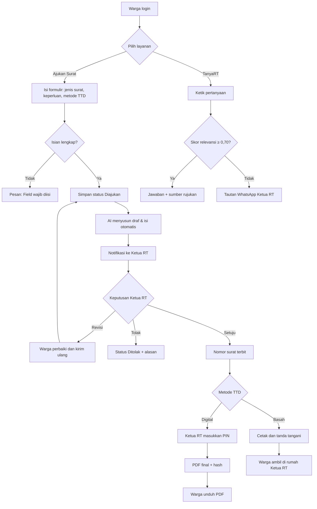

<div align="center">


<p><strong>Administrasi RT/RW dari rumah, dibantu Generative AI</strong><br>
Warga mengajukan surat pengantar secara daring, Ketua RT mengesahkannya dengan satu PIN, dan pertanyaan seputar layanan RT dijawab chatbot 24 jam.</p>

<p>
  
  
  
  
  
  
  
</p>

<p>
  <a href="#fitur">Fitur</a> ·
  <a href="#arsitektur">Arsitektur</a> ·
  <a href="#subdirectories--system-boundaries">Subdirektori & Batasan</a> ·
  <a href="#tech-stack-dan-alasannya">Tech Stack</a> ·
  <a href="#skema-database">Database</a> ·
  <a href="#memulai">Memulai</a> ·
  <a href="#system-verification">Verifikasi</a> ·
  <a href="#aturan-kontribusi">Kontribusi</a>
</p>

</div>

---

RTConnect adalah aplikasi web dan mobile untuk administrasi tingkat RT/RW. Sistem ini dikembangkan untuk warga dan pengurus **RT 032 RW 08 Griya Taman Asri, Desa Tawangsari, Kecamatan Taman, Kabupaten Sidoarjo**. Dengan RTConnect:

- **warga mengajukan surat pengantar** secara daring, dengan data diri terisi otomatis dari profil akun;
- **Generative AI menyusun draf surat** formal dan membantu pengisian otomatis data pemohon;
- **Ketua RT meninjau dan memutuskan** pengajuan (Setuju, Revisi, atau Tolak), lalu mengesahkan surat dengan **tanda tangan digital ber-PIN** atau **tanda tangan basah**;
- **warga mengunduh surat resmi** dalam bentuk PDF yang divalidasi keasliannya;
- **chatbot TanyaRT** menjawab pertanyaan syarat dan prosedur layanan RT secara deterministik/leksikal dari dokumen resmi, serta mengekskalasikan ke WhatsApp Ketua RT bila di luar cakupan.

## Daftar Isi

- [Latar Belakang](#latar-belakang)
- [Pengguna](#pengguna)
- [Fitur](#fitur)
- [Alur Pengguna](#alur-pengguna)
- [Arsitektur](#arsitektur)
- [Local Interface & Invariants](#local-interface--invariants)
- [Subdirectories & System Boundaries](#subdirectories--system-boundaries)
- [Global Invariants](#global-invariants)
- [Global Side Effects](#global-side-effects)
- [Tech Stack dan Alasannya](#tech-stack-dan-alasannya)
- [Skema Database](#skema-database)
- [Aturan Bisnis](#aturan-bisnis)
- [Keamanan](#keamanan)
- [Target Kinerja](#target-kinerja)
- [Struktur Repo](#struktur-repo)
- [Memulai](#memulai)
- [System Verification](#system-verification)
- [Aturan Kontribusi](#aturan-kontribusi)
- [Tim](#tim)

## Latar Belakang

Sebelum RTConnect, layanan administrasi di RT 032 berjalan semi-manual:

- warga mengajukan surat lewat aplikasi Sayang Warga atau WhatsApp pribadi Ketua RT;
- Ketua RT mengetik ulang biodata dan tujuan surat satu per satu, lalu menandatangani dan memberi tahu warga secara manual;
- pertanyaan tentang syarat dan prosedur dijawab lewat chat pribadi atau janji temu, sehingga pertanyaan yang sama dijawab berulang kali.

RTConnect memindahkan seluruh alur tersebut ke satu aplikasi. Pengajuan dan arsip surat tercatat rapi, draf surat disusun otomatis, dan pertanyaan rutin terjawab tanpa menunggu Ketua RT.

## Pengguna

| Pengguna | Karakteristik | Akses |
|---|---|---|
| Warga | Warga RT 032 dengan literasi teknologi dasar hingga menengah, memakai ponsel atau peramban. Butuh cara mengajukan surat dari rumah dan informasi syarat layanan yang cepat. | Registrasi dengan NIK + login |
| Ketua RT | Pengurus yang berwenang meninjau, mengesahkan, dan menerbitkan surat, dengan waktu terbatas di luar pekerjaan utama. | Login dengan peran `rt` + PIN pengesahan |

## Fitur

Versi pertama mencakup empat use case utama:

| Kode | Use case | Pengguna | Prioritas | Ringkasan |
|---|---|---|---|---|
| UC-01 | Mengajukan Surat Pengantar | Warga | Must Have | Pilih jenis surat, isi keperluan, pilih metode TTD, lampiran opsional. Draf disusun AI (fallback ke template baku). Termasuk kirim ulang revisi. |
| UC-02 | Meninjau dan Menindaklanjuti Pengajuan | Ketua RT | Must Have | Tinjau data, lampiran, dan draf. Putuskan Setuju, Revisi, atau Tolak. Terbitkan nomor surat, sahkan dengan PIN (digital) atau cetak (basah). |
| UC-03 | Mendownload Surat Pengantar | Warga | Must Have | Unduh PDF untuk TTD digital, atau lihat petunjuk pengambilan untuk TTD basah. |
| UC-04 | Bertanya kepada Chatbot | Warga | Must Have | Jawaban RAG leksikal dari basis pengetahuan RT beserta sumbernya. Skor < 0,70 dialihkan ke WhatsApp Ketua RT. |

Jenis surat yang dilayani: **Surat Keterangan Domisili**, **Surat Pengantar KTP/KK**, **Surat Pengantar SKCK**, dan **Surat Keterangan Usaha (SKU)**.

Status pengajuan berjalan sebagai berikut:



## Alur Pengguna



## Arsitektur

RTConnect mengadopsi arsitektur **Client-Server berbasis RESTful API**:

1. **Presentation Tier (Flutter Client)**: Satu basis kode Dart multi-platform (Android, Web, iOS, Desktop) pada `frontend/lib/`.
2. **Application Tier (Flask REST API)**: Layanan Python Flask pada `backend/` dengan autentikasi JWT, state machine persuratan, rendering PDF ReportLab, dan RAG TanyaRT.
3. **Persistence Tier (PostgreSQL / Supabase)**: Database relasional menyimpan profil warga/RT, pengajuan surat, arsip surat resmi, knowledge base, dan notifikasi. Berkas privat disimpan di penyimpanan lokal atau S3 bucket.
4. **External Services**: Google Gemini API untuk pengisian formulir cerdas (AI Fill), Firebase Cloud Messaging (FCM) untuk push notification, dan WhatsApp Gateway (`wa.me`) untuk eskalasi.

## Local Interface & Invariants

Root repositori menyediakan utilitas proxy pengembangan lokal:

- `dev_proxy.py`:
  - `DevProxyHandler`: HTTP reverse proxy yang memetakan permintaan `/api/*` ke backend (`http://127.0.0.1:5000`) dan rute lainnya ke frontend (`http://127.0.0.1:3000`).
  - `run()`: Menjalankan `socketserver.TCPServer` pada port `8080` (`0.0.0.0:8080`) dengan `allow_reuse_address = True`.
- Invariant: Jalur URL yang diawali `/api/` wajib diarahkan ke `BACKEND_URL`, selainnya diarahkan ke `FRONTEND_URL`. Header hop-by-hop (`Transfer-Encoding`, `Content-Length`) dilucuti sebelum re-forwarding.
- Efek Samping: Membuka TCP listening socket di port 8080 dan membuat koneksi keluar HTTP via `urllib.request`.

## Subdirectories & System Boundaries

- [Backend](./backend/README.md): RESTful API Flask (`/api/v1`) untuk autentikasi, manajemen surat pengantar, BDD behave tests, migrasi database, dan layanan TanyaRT RAG.
- [Frontend](./frontend/README.md): Klien Flutter multi-platform mengimplementasikan Material 3 design tokens, Riverpod state management, dan GoRouter navigation.

## Global Invariants

1. **API Namespace & Envelope**: Semua endpoint backend terpusat di bawah prefix `/api/v1` dan mengembalikan format respons standar `{success: bool, message: str, data: any, error: any}`.
2. **Role-Based Access Control (RBAC)**: Endpoint dilindungi melalui Bearer JWT token HS256 dengan pemisahan peran ketat (`warga`, `rt`, `admin`).
3. **Integritas Penomoran Surat**: Nomor surat resmi hanya diterbitkan secara unik saat Ketua RT mengambil keputusan "Setuju" (`Disetujui`), menggunakan locking per-transaksi untuk mencegah duplikasi.
4. **Keamanan Pengesahan Digital**: Pengesahan digital surat mewajibkan verifikasi hash PIN Ketua RT (`RT_SIGNING_PIN_HASH`), dengan proteksi rate limit dan kunci akun sementara setelah 5 kali gagal.
5. **RAG Scope Guard**: Chatbot TanyaRT di runtime beroperasi secara leksikal deterministik tanpa ketergantungan model ML berat di server produksi; kueri di luar lingkup RT ditolak dengan `LUAR_CAKUPAN` atau dialihkan ke WhatsApp.
6. **Perlindungan Data Pribadi (PDP)**: NIK dan data rahasia dilindungi; kunci API eksternal (Gemini, Firebase) hanya disimpan di server environment variables.

## Global Side Effects

- **Database Relasional**: Operasi baca/tulis pool TCP/TLS pada PostgreSQL / Supabase untuk akun, transaksi pengajuan, sesi obrolan, dan notifikasi.
- **Penyimpanan Berkas Privat**: Pembuatan berkas PDF resmi, spesimen tanda tangan, avatar pengguna, dan dokumen lampiran di direktori privat lokal `backend/uploads` atau bucket Amazon S3 kompatibel.
- **Layanan Pihak Ketiga**:
  - Outbound HTTPS ke Google Gemini API untuk ekstraksi data formulir otomatis.
  - Outbound HTTP/2 ke Firebase Cloud Messaging (FCM) untuk pengiriman push notification perangkat warga dan RT.
  - Redirection ke WhatsApp Web/App (`wa.me`) untuk eskalasi pertanyaan warga.

## Tech Stack dan Alasannya

| Lapisan | Pilihan | Alasan |
|---|---|---|
| Frontend | **Flutter (Dart)** | Satu basis kode untuk Android, iOS, dan web, sesuai target perangkat warga yang beragam. Komponen Material 3 memudahkan target sentuh ≥ 48 dp dan kontras WCAG 2.1 AA. |
| Backend | **Python Flask 3.1** | Ringan dan mudah dipahami tim. Ekosistem Python kuat untuk integrasi AI, BDD, dan pembuatan PDF. |
| Database | **PostgreSQL / Supabase** | Data bersifat relasional (warga, pengajuan, surat final, notifikasi). Mendukung transaksi, connection pooling (`psycopg_pool`), dan migrasi SQL terstruktur. |
| LLM | **Gemini API** | Ekstraksi entitas cerdas dan pengisian data formulir surat secara otomatis (AI Fill). |
| Autentikasi | **PyJWT + bcrypt** | Token HS256 berlaku maksimal 24 jam. Password dan PIN pengesahan disimpan sebagai hash bcrypt. |
| Web Server | **Gunicorn / Werkzeug** | Gunicorn untuk produksi kontainer Docker, Werkzeug untuk pengembangan lokal. |

## Skema Database

Skema database PostgreSQL / Supabase ternormalisasi:

### Akun dan Surat

| Tabel | Kolom Utama | Catatan |
|---|---|---|
| `warga` / `users` | `id` / `user_id` (PK), `nik` (UQ), `nama_lengkap`, `email` (UQ), `password_hash`, `nomor_telepon`, `alamat`, `peran`, `tanda_tangan_url`, `is_active`, `fcm_token` | Warga terdaftar dengan identitas kependudukan terverifikasi. |
| `rt` | `id` (PK), `user_id` (FK), `pin_hash`, `gagal_count`, `locked_until` | Akun pengurus RT berwenang mengesahkan surat. |
| `jenis_surat` | `id` (PK), `kode_surat` (UQ), `nama_surat`, `template_dokumen`, `persyaratan_dokumen`, `is_aktif` | Master template jenis surat resmi. |
| `pengajuansurat` | `id` (PK), `nomor_pengajuan` (UQ), `warga_id` (FK), `jenis_surat_id` (FK), `keperluan`, `metode_tanda_tangan`, `status_surat`, `data_pemohon`, `lampiran_path` | Transaksi pengajuan surat, snapshot demografi, dan status verifikasi. |
| `surat_final` | `id` (PK), `pengajuan_id` (FK, UQ), `nomor_surat_resmi` (UQ), `file_pdf_path`, `tanggal_terbit`, `status_pengesahan` | Arsip surat resmi bertanda tangan digital/basah. |

### Chatbot dan Notifikasi

| Tabel | Kolom Utama | Catatan |
|---|---|---|
| `knowledge_chunks` | `id` (PK), `kode_sumber`, `judul`, `isi_chunk`, `topik`, `kata_kunci` | Potongan basis pengetahuan resmi RT 032 untuk RAG leksikal. |
| `chat_sessions` | `id` (PK), `warga_id` (FK), `status_sesi`, `started_at` | Sesi percakapan konsultasi warga. |
| `chat_messages` | `id` (PK), `session_id` (FK), `pengirim`, `isi_pesan`, `similarity_score` | Pesan obrolan warga dan asisten TanyaRT. |
| `notifikasi` | `id` (PK), `penerima_id` (FK), `tipe_notifikasi`, `judul`, `pesan_notifikasi`, `is_dibaca` | Riwayat notifikasi sistem dan status pengajuan surat. |

## Aturan Bisnis

| Kode | Aturan |
|---|---|
| BR-1 | Hanya warga dengan akun terverifikasi yang dapat mengajukan surat pengantar. |
| BR-2 | Satu NIK dan satu email hanya untuk satu akun. |
| BR-3 | Hanya akun berperan `rt` / `admin` yang dapat meninjau, menyetujui, meminta revisi, menolak, dan mengesahkan surat. |
| BR-4 | Penolakan wajib disertai alasan penolakan; permintaan revisi wajib disertai catatan perbaikan. |
| BR-5 | Pengajuan yang direvisi kembali berstatus "Diajukan" dan wajib ditinjau ulang oleh RT. |
| BR-6 | Nomor surat resmi hanya terbit setelah keputusan Disetujui dan bersifat unik secara sekuensial. |
| BR-7 | Metode TTD dipilih warga saat pengajuan: TTD digital diunduh PDF, TTD basah dicetak dan diambil di kediaman RT. |
| BR-8 | Draf otomatis hanya usulan asistensi dan tidak sah sebelum disahkan dengan PIN RT. |
| BR-9 | TanyaRT hanya melayani pertanyaan informasi tata tertib dan prosedur yang tercantum di knowledge base resmi. |

## Keamanan

- Komunikasi seluruh data wajib menggunakan HTTPS (TLS 1.2+).
- Setiap endpoint terproteksi memvalidasi header `Authorization: Bearer <JWT>` (HS256).
- Penyematan TTD digital wajib diotorisasi **PIN 6 digit** Ketua RT. Kegagalan 5 kali berturut-turut memicu penguncian akun selama **15 menit**.
- PDF final mencantumkan QR code verifikasi dan nomor surat resmi.
- Sanitasi input dan proteksi MIME type diterapkan pada seluruh unggahan berkas.

## Target Kinerja

| Aspek | Target |
|---|---|
| Muat halaman, daftar pengajuan, dan login | ≤ 2 detik |
| Pembuatan draf surat & ekstraksi data pemohon | ≤ 5 detik |
| Balasan TanyaRT per pertanyaan | ≤ 2 detik |
| Pembuatan berkas PDF surat final | ≤ 3 detik |
| Ketersediaan layanan per bulan | ≥ 99,0% |

## Struktur Repo

```
.
├── backend/                       # RESTful API Python Flask
│   ├── chatbot/                   # Offline evaluation & lexical heuristics
│   ├── database/                  # Connection pooling, DDL & migrations
│   ├── features/                  # BDD acceptance test suite (Behave)
│   ├── middleware/                # JWT verification & RBAC guards
│   ├── routes/                    # Blueprint routes (/auth, /letters, /chatbot, /notifications)
│   ├── services/                  # PDF rendering, RAG ranking, PIN guard, AI fill
│   ├── supabase_connect/          # Supabase SDK integration
│   ├── app.py                     # Entry point Flask application
│   └── requirements.txt           # Python dependency manifest
├── frontend/                      # Klien multi-platform Flutter
│   ├── lib/
│   │   ├── core/                  # Constants, network, router, theme, services
│   │   ├── features/              # Modular features (auth, letters, chatbot, profile, etc.)
│   │   ├── shared/                # Reusable UI primitives & navigation
│   │   └── main.dart              # Flutter application entry point
│   ├── test/                      # Unit & widget tests
│   └── pubspec.yaml               # Flutter dependency manifest
├── docs/                          # Dokumentasi, aset visual, dan logo
├── dev_proxy.py                   # Local development reverse proxy (port 8080)
├── compose.yaml                   # Docker Compose multi-service definition
├── DEPLOYMENT.md                  # Panduan deployment produksi
└── README.md                      # Blueprint Hay repositori utama
```

## Memulai

Prasyarat: Git, Flutter SDK 3.24+, Python 3.10+, Docker / Compose.

### Menjalankan Backend (Lokal)
```bash
cd backend
pip install -r requirements.txt
python -m database.migrate
python -m database.seed
python app.py
```

### Menjalankan Frontend (Lokal)
```bash
cd frontend
flutter pub get
flutter run
```

### Menjalankan Stack via Docker Compose
```bash
docker compose up --build
```

## System Verification

Jalankan rangkaian pengujian otomatis untuk memverifikasi fungsionalitas sistem:

- **Backend Integration Tests**:
  ```bash
  cd backend && python test_api.py
  ```
- **Backend BDD Acceptance Tests**:
  ```bash
  cd backend && python run_bdd.py
  ```
- **Frontend Unit & Widget Tests**:
  ```bash
  cd frontend && flutter test
  ```
- **Frontend Static Analysis**:
  ```bash
  cd frontend && flutter analyze
  ```

## Aturan Kontribusi

- Sumber kebenaran kebutuhan sistem adalah SRS RTConnect v1.0.
- Gunakan branch dengan konvensi `<tipe>/<fitur>` (contoh: `feat/pengajuan-surat`, `fix/pin-dialog`).
- Setiap perubahan wajib lulus pengujian `flutter test`, `flutter analyze`, dan `python test_api.py`.
- Jangan pernah menyimpan token rahasia, kunci privat, atau file `.env` ke repositori git.

## Tim

Kelompok 3, Praktikum Pembangunan Perangkat Lunak Kelas I1. Dosen pengampu: Dr. Indra Kharisma Raharjana, S.Kom., M.T.

| Nama | NIM |
|---|---|
| Muhammad Nafidz Arradhin | 187241027 |
| Mirza Diwa Luscakson | 187241042 |
| Febrian Muhammad Yudhistira | 187241051 |
| Ahmad Dhafin Al Farisy | 187241057 |

---

<div align="center">
  <br>
  <sub>RTConnect · Kelompok 3 PPL Praktikum I1 · S1 Sistem Informasi, FST Universitas Airlangga</sub>
</div>
