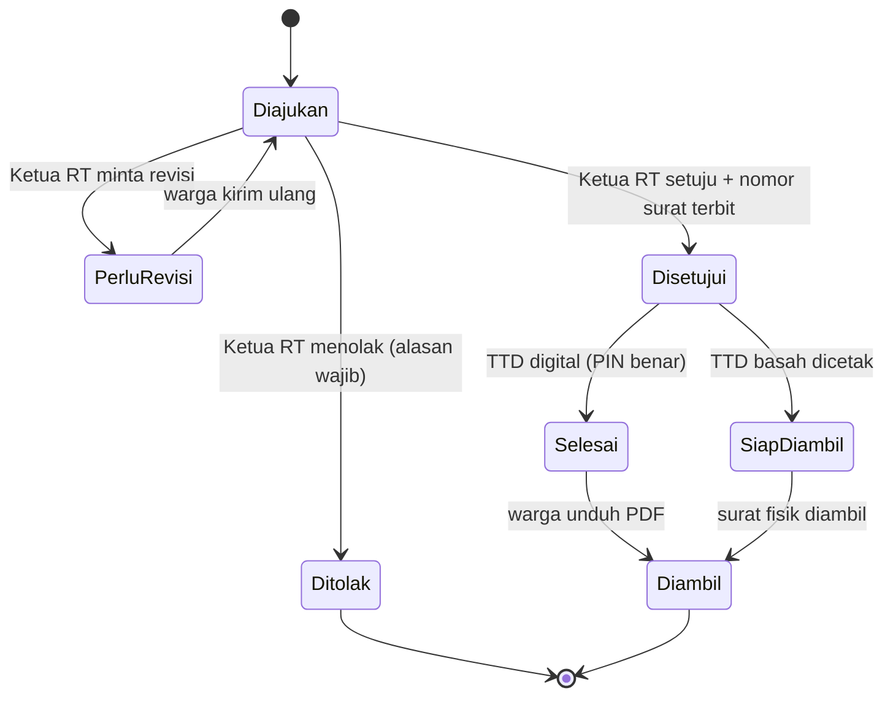
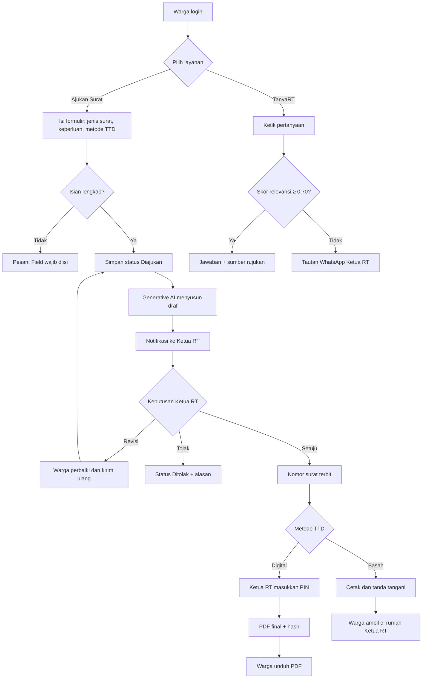
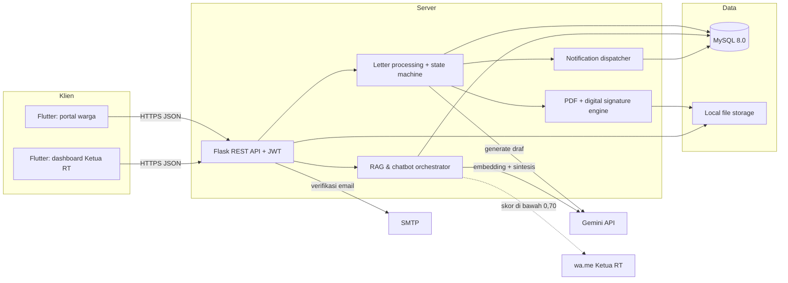
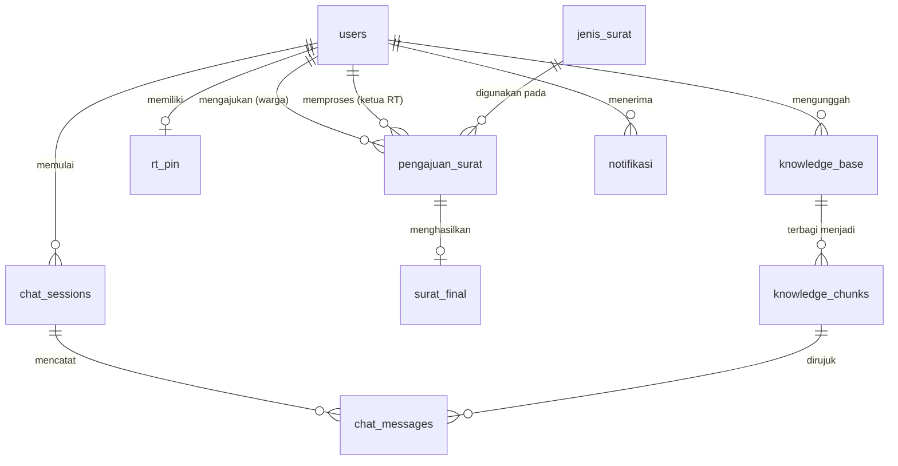

<div align="center">


<p><strong>Administrasi RT/RW dari rumah, dibantu Generative AI</strong><br>
Warga mengajukan surat pengantar secara daring, Ketua RT mengesahkannya dengan satu PIN, dan pertanyaan seputar layanan RT dijawab chatbot 24 jam.</p>

<p>
  
  
  
  
  
  
  
</p>

<p>
  <a href="#fitur">Fitur</a> ·
  <a href="#arsitektur">Arsitektur</a> ·
  <a href="#tech-stack-dan-alasannya">Tech Stack</a> ·
  <a href="#skema-database">Database</a> ·
  <a href="#memulai">Memulai</a> ·
  <a href="#aturan-kontribusi">Kontribusi</a>
</p>

</div>

---

RTConnect adalah aplikasi web dan mobile untuk administrasi tingkat RT/RW. Sistem ini dikembangkan untuk warga dan pengurus **RT 032 RW 08 Griya Taman Asri, Desa Tawangsari, Kecamatan Taman, Kabupaten Sidoarjo**. Dengan RTConnect:

- **warga mengajukan surat pengantar** secara daring, dengan data diri terisi otomatis dari profil akun;
- **Generative AI menyusun draf surat** formal, sehingga Ketua RT tidak perlu mengetik ulang;
- **Ketua RT meninjau dan memutuskan** pengajuan (Setuju, Revisi, atau Tolak), lalu mengesahkan surat dengan **tanda tangan digital ber-PIN** atau **tanda tangan basah**;
- **warga mengunduh surat resmi** dalam bentuk PDF yang bisa divalidasi keasliannya;
- **chatbot TanyaRT** menjawab pertanyaan syarat dan prosedur layanan RT dari dokumen resmi, dan meneruskan ke WhatsApp Ketua RT bila jawabannya tidak ditemukan.

## Daftar Isi

- [Latar Belakang](#latar-belakang)
- [Pengguna](#pengguna)
- [Fitur](#fitur)
- [Alur Pengguna](#alur-pengguna)
- [Arsitektur](#arsitektur)
- [Tech Stack dan Alasannya](#tech-stack-dan-alasannya)
- [Skema Database](#skema-database)
- [Aturan Bisnis](#aturan-bisnis)
- [Keamanan](#keamanan)
- [Target Kinerja](#target-kinerja)
- [Struktur Repo](#struktur-repo)
- [Memulai](#memulai)
- [Aturan Kontribusi](#aturan-kontribusi)
- [Tim](#tim)

## Latar Belakang

Sebelum RTConnect, layanan administrasi di RT 032 berjalan semi-manual:

- warga mengajukan surat lewat aplikasi Sayang Warga atau WhatsApp pribadi Ketua RT;
- Ketua RT mengetik ulang biodata dan tujuan surat satu per satu, lalu menandatangani dan memberi tahu warga secara manual;
- pertanyaan tentang syarat dan prosedur dijawab lewat chat pribadi atau janji temu, sehingga pertanyaan yang sama dijawab berulang kali.

RTConnect memindahkan seluruh alur tersebut ke satu aplikasi. Pengajuan dan arsip surat tercatat rapi, draf surat disusun otomatis, dan pertanyaan rutin terjawab tanpa menunggu Ketua RT.

**Di luar cakupan versi 1:** jenis dokumen selain surat pengantar dan surat keterangan standar tingkat RT/RW, wilayah selain RT 032 RW 08, serta penggunaan Generative AI di luar penyusunan draf surat dan jawaban chatbot.

## Pengguna

| Pengguna | Karakteristik | Akses |
|---|---|---|
| Warga | Warga RT 032 dengan literasi teknologi dasar hingga menengah, memakai ponsel atau peramban. Butuh cara mengajukan surat dari rumah dan informasi syarat layanan yang cepat. | Registrasi dengan NIK + login |
| Ketua RT | Pengurus yang berwenang meninjau, mengesahkan, dan menerbitkan surat, dengan waktu terbatas di luar pekerjaan utama. | Login dengan peran `ketua_rt` + PIN pengesahan |

## Fitur

Versi pertama mencakup empat use case dari SRS v1.0.

| Kode | Use case | Pengguna | Prioritas | Ringkasan |
|---|---|---|---|---|
| UC-01 | Mengajukan Surat Pengantar | Warga | Must Have | Pilih jenis surat, isi keperluan, pilih metode TTD, lampiran opsional. Draf disusun AI (fallback ke template baku). Termasuk kirim ulang revisi. |
| UC-02 | Meninjau dan Menindaklanjuti Pengajuan | Ketua RT | Must Have | Tinjau data, lampiran, dan draf. Putuskan Setuju, Revisi, atau Tolak. Terbitkan nomor surat, sahkan dengan PIN (digital) atau cetak (basah). |
| UC-03 | Mendownload Surat Pengantar | Warga | Must Have | Unduh PDF untuk TTD digital, atau lihat petunjuk pengambilan untuk TTD basah. |
| UC-04 | Bertanya kepada Chatbot | Warga | Must Have (tanya jawab), Should Have (eskalasi) | Jawaban RAG dari basis pengetahuan RT beserta sumbernya. Skor < 0,70 dialihkan ke WhatsApp Ketua RT. |

Jenis surat yang dilayani: **Surat Keterangan Domisili**, **Surat Pengantar KTP/KK**, **Surat Pengantar SKCK**, dan **Surat Keterangan Usaha (SKU)**.

Status pengajuan berjalan sebagai berikut:



Halaman yang dibangun:

| Halaman | Pengguna | UC |
|---|---|---|
| Beranda Warga | Warga | UC-01, UC-04 |
| Beranda RT | Ketua RT | UC-02 |
| Side Bar (profil, riwayat, notifikasi, pengaturan, log out) | Semua | |
| Riwayat Pengajuan | Warga | UC-01, UC-03 |
| Formulir Pengajuan Baru | Warga | UC-01 |
| Kelola Pengajuan (Pengajuan Warga) | Ketua RT | UC-02 |
| Detail Pengajuan + Pratinjau Draf Resmi | Ketua RT | UC-02 |
| Pop Up PIN Keamanan | Ketua RT | UC-02 |
| Chatbot TanyaRT | Warga | UC-04 |

Desain lengkap ada di [Figma PPL-PRAK](https://www.figma.com/design/VxiqwNqnwEY8UU2FGRzy0u/PPL-PRAK?node-id=0-1).

## Alur Pengguna



## Arsitektur

RTConnect memakai arsitektur **Client-Server berbasis RESTful API** dengan pola **MVC**, terbagi menjadi empat tingkatan:

1. **Presentation tier (Flutter).** Satu basis kode untuk aplikasi mobile dan web: portal warga (formulir, riwayat, chatbot) dan dashboard Ketua RT (antrean, peninjauan, tindak lanjut).
2. **Application tier (Python Flask).** REST API dengan autentikasi JWT, *state machine* status pengajuan, orkestrasi RAG dan chatbot, pembuat PDF dan tanda tangan digital, serta pengirim notifikasi.
3. **Persistence tier (MySQL 8.0).** Data pengguna, pengajuan, surat final, basis pengetahuan, riwayat chat, dan notifikasi. Berkas (spesimen TTD, lampiran, PDF final) disimpan di penyimpanan server, path-nya dicatat di database.
4. **Layanan eksternal.** Gemini API untuk draf surat dan jawaban chatbot, model embedding untuk pencarian semantik, WhatsApp URL Gateway (`wa.me`) untuk eskalasi, dan SMTP untuk email verifikasi registrasi.



## Tech Stack dan Alasannya

| Lapisan | Pilihan | Alasan |
|---|---|---|
| Frontend | **Flutter (Dart)** | Satu basis kode untuk Android, iOS, dan web, sesuai target perangkat warga yang beragam. Komponen Material 3 memudahkan target sentuh ≥ 48 dp dan kontras WCAG 2.1 AA. |
| Backend | **Python Flask 3.1** | Ringan dan mudah dipahami tim. Ekosistem Python kuat untuk integrasi AI, embedding, dan pembuatan PDF. |
| Database | **MySQL 8.0 / 8.4 LTS** | Data bersifat relasional (warga, pengajuan, surat final, notifikasi). Mendukung transaksi dan `SELECT ... FOR UPDATE` sehingga nomor surat tidak dobel. Mudah dijalankan lewat Laragon saat pengembangan. |
| LLM | **Gemini API** | Menyusun draf surat berbahasa Indonesia baku dan menyintesis jawaban chatbot hanya dari potongan dokumen yang diambil. |
| Autentikasi | **PyJWT + bcrypt** | Token HS256 berlaku maksimal 24 jam. Password dan PIN disimpan sebagai hash bcrypt. |
| Web server | **Gunicorn / Werkzeug** | Gunicorn untuk produksi, Werkzeug untuk pengembangan lokal. |

**Konsekuensi yang harus ditangani:**

- Sistem bergantung pada koneksi internet dan kuota token Gemini API. Bila layanan AI gagal atau melebihi 15 detik, draf memakai template baku dan chatbot menampilkan tautan WhatsApp.
- NIK tidak boleh dikirim ke layanan AI pihak ketiga (UU No. 27 Tahun 2022 tentang PDP).
- Kunci API hanya disimpan di server sebagai environment variable, tidak pernah dikirim ke klien.

## Skema Database

Database bernama `rtconnect_db` (MySQL 8.0), ternormalisasi minimal 3NF.

### Akun dan surat

| Tabel | Kolom utama | Catatan |
|---|---|---|
| `users` | `user_id` (PK), `nik` (UQ), `nama_lengkap`, `email` (UQ), `password_hash`, `nomor_telepon`, `alamat`, `role`, `tanda_tangan_url`, `is_active`, `created_at` | Warga dan Ketua RT dalam satu tabel, dibedakan kolom `role`. |
| `jenis_surat` | `jenis_surat_id` (PK), `kode_surat` (UQ), `nama_surat`, `template_dokumen`, `persyaratan_dokumen`, `is_aktif` | Master jenis surat beserta templatenya. |
| `pengajuan_surat` | `pengajuan_id` (PK), `nomor_pengajuan` (UQ), `warga_id` (FK), `rt_id` (FK), `jenis_surat_id` (FK), `keperluan`, `metode_tanda_tangan`, `berkas_lampiran_url`, `draf_ai_konten`, `status`, `catatan_revisi`, `alasan_penolakan`, `tanggal_pengajuan` | Transaksi pengajuan, draf AI, dan keputusan RT. |
| `surat_final` | `surat_final_id` (PK), `pengajuan_id` (FK, UQ), `nomor_surat_resmi` (UQ), `file_pdf_path`, `signature_image_path`, `status_pengesahan`, `tanggal_terbit`, `tanggal_diambil` | Arsip surat resmi. Surat yang sudah disahkan tidak dapat diubah. |
| `nomor_surat_counter` | `tahun` (PK), `last_number` | Nomor urut surat per tahun, dikunci per transaksi. |
| `rt_pin` | `rt_id` (PK, FK), `pin_hash`, `gagal_count`, `locked_until` | PIN pengesahan Ketua RT dan penguncian setelah 5 kali salah. |

### Chatbot dan notifikasi

| Tabel | Kolom utama | Catatan |
|---|---|---|
| `knowledge_base` | `knowledge_id` (PK), `judul_dokumen`, `kategori`, `isi_dokumen`, `diunggah_oleh_rt` (FK), `created_at`, `updated_at` | Dokumen tata tertib dan prosedur RT 032. |
| `knowledge_chunks` | `chunk_id` (PK), `knowledge_id` (FK), `urutan_chunk`, `isi_chunk`, `embedding_vector` (JSON) | Potongan dokumen dan vektor RAG. |
| `chat_sessions` | `session_id` (PK), `warga_id` (FK), `status_sesi`, `started_at`, `ended_at` | Sesi percakapan chatbot. |
| `chat_messages` | `message_id` (PK), `session_id` (FK), `pengirim`, `isi_pesan`, `top_chunk_id` (FK), `similarity_score`, `waktu_kirim` | Pesan, skor kemiripan, dan rujukan. |
| `notifikasi` | `notifikasi_id` (PK), `penerima_id` (FK), `tipe_notifikasi`, `judul`, `pesan_notifikasi`, `is_dibaca`, `created_at` | Notifikasi status pengajuan dan eskalasi. |

### Diagram relasi



## Aturan Bisnis

| Kode | Aturan |
|---|---|
| BR-1 | Hanya warga RT 032 RW 08 dengan akun terverifikasi yang dapat mengajukan surat pengantar. |
| BR-2 | Satu NIK dan satu email hanya untuk satu akun. |
| BR-3 | Hanya pengguna berperan Ketua RT yang dapat meninjau, menyetujui, meminta revisi, menolak, dan mengesahkan surat. |
| BR-4 | Penolakan wajib disertai alasan, permintaan revisi wajib disertai catatan perbaikan. |
| BR-5 | Pengajuan yang direvisi kembali berstatus "Diajukan" dan wajib ditinjau ulang. |
| BR-6 | Nomor surat resmi hanya terbit setelah keputusan Setuju dan bersifat unik. |
| BR-7 | Metode TTD dipilih warga saat pengajuan. Surat digital diunduh sebagai PDF, surat basah diambil di rumah Ketua RT. |
| BR-8 | Draf AI hanya usulan dan tidak sah sebelum disetujui dan ditandatangani Ketua RT. |
| BR-9 | Chatbot hanya menjawab pertanyaan seputar syarat, prosedur, dan aturan RT yang ada di basis pengetahuan. |

## Keamanan

- Semua komunikasi memakai HTTPS (TLS 1.2+, target TLS 1.3).
- Setiap endpoint terproteksi memvalidasi header `Authorization: Bearer <JWT>` (HS256, maksimal 24 jam).
- Warga hanya bisa melihat pengajuan dan surat miliknya. Berkas surat hanya dapat diunduh oleh pemilik pengajuan.
- Penyematan TTD digital wajib diotorisasi **PIN 6 digit** Ketua RT. Setelah **5 kali salah berturut-turut**, PIN dikunci **15 menit**.
- PDF final menyimpan **hash** dokumen untuk validasi keaslian.
- Basis data dicadangkan otomatis minimal sekali sehari dengan retensi 30 hari.

## Target Kinerja

| Aspek | Target |
|---|---|
| Muat halaman, daftar pengajuan, dan login (koneksi 5 Mbps) | ≤ 2 detik |
| Pembuatan draf surat oleh Generative AI | ≤ 5 detik (fallback template bila > 15 detik) |
| Balasan chatbot per pertanyaan | ≤ 5 detik |
| Pembuatan dan pengiriman PDF surat final | ≤ 3 detik |
| Pengguna serentak | ≥ 50 |
| Ketersediaan per bulan | ≥ 99,0% |
| Skor System Usability Scale (SUS) | ≥ 70 |

## Struktur Repo

```
.
├── docs/
│   └── assets/                 # logo RTConnect
├── lib/                        # aplikasi Flutter
│   ├── main.dart
│   └── features/
│       └── pengajuan_rt/       # Kelola & Detail Pengajuan, PIN Keamanan (UC-02)
│           ├── models/
│           ├── pages/
│           ├── services/       # ApiPengajuanRtService (Flask) + MockPengajuanRtService
│           └── widgets/
├── test/                       # widget test Flutter
├── android/ ios/ web/ ...      # platform Flutter
└── backend/                    # (direncanakan) Flask REST API
    ├── app/
    │   ├── routes/
    │   └── services/           # nomor_surat_service, pin_service, ...
    ├── sql/                    # skema & migrasi MySQL
    └── requirements.txt
```

## Memulai

Prasyarat: Git, Flutter SDK 3.24 atau lebih baru, dan Android Studio atau VS Code. Untuk backend: Python 3.10+ dan MySQL 8.0 (disarankan lewat Laragon).

```bash
git clone https://github.com/AgilePemdigi-2026/RTConnect.git
cd RTConnect
flutter pub get
flutter run
```

Sementara backend belum terhubung, aplikasi memakai data tiruan (`MockPengajuanRtService`). PIN tiruan untuk mencoba alur pengesahan digital adalah `482913`.

| Perintah | Fungsi |
|---|---|
| `flutter run` | Menjalankan aplikasi di emulator, perangkat, atau Chrome |
| `flutter run -d chrome` | Menjalankan versi web |
| `flutter test` | Menjalankan widget test |
| `flutter build apk` | Build APK Android |

Untuk menyambungkan ke backend Flask, ganti service di `lib/main.dart`:

```dart
ApiPengajuanRtService(
  baseUrl: 'http://10.0.2.2:5000/api', // emulator Android → localhost laptop
  tokenProvider: () => token,
)
```

Kredensial (kunci Gemini API, secret JWT, koneksi MySQL, SMTP) disimpan di `.env` dan **tidak pernah di-commit**.

## Aturan Kontribusi

- **Sumber kebenaran** adalah SRS RTConnect v1.0. Perubahan kebutuhan dicatat di SRS lebih dulu, baru kode menyusul.
- **Teks UI dan pesan sistem** mengikuti SRS dan desain Figma, misalnya "Field wajib diisi" dan "Pengajuan Berhasil Dikirim".
- **Branch** memakai pola `<tipe>/<fitur>`, misalnya `feat/pengajuan-rt` atau `fix/popup-pin`. Jangan push langsung ke `main`.
- **Pull request** ke `main` minimal direview satu anggota lain sebelum di-merge.
- **Commit** ditulis singkat dan jelas, misalnya `feat: tambah popup PIN keamanan TTD digital`.
- **Tanpa rahasia di repo.** Semua kredensial lewat environment variable.

## Tim

Kelompok 3, Praktikum Pembangunan Perangkat Lunak Kelas I1. Dosen pengampu: Dr. Indra Kharisma Raharjana, S.Kom., M.T.

| Nama | NIM |
|---|---|
| Muhammad Nafidz Arradhin | 187241027 |
| Mirza Diwa Luscakson | 187241042 |
| Febrian Muhammad Yudhistira | 187241051 |
| Ahmad Dhafin Al Farisy | 187241057 |

---

<div align="center">
  <br>
  <sub>RTConnect · Kelompok 3 PPL Praktikum I1 · S1 Sistem Informasi, FST Universitas Airlangga</sub>
</div>
