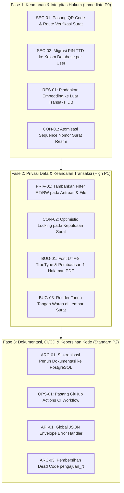

# RTConnect Comprehensive Project Health, Security & Resilience Audit Report

* **Date:** 2026-11-25
* **Auditor Framework:** Elephant & Goldfish Model (EGM) Multi-Agent Swarm
* **Auditor Personas:**
  - `egm-design`: Hostile Design & Security Critic
  - `egm-codebase-details`: Pedantic Technical Quality & Edge Cases Auditor
  - `egm-zoom-out`: Skeptical Architect & Structural Auditor
* **Audit Scope:** Authentication, Authorization, Digital Signing Security, Data Privacy (UU PDP), Concurrency & Race Conditions, SQL Safety & Transaction Management, PDF Pipeline, Drift & CI/CD Infrastructure.

---

## Executive Summary

Audit menyeluruh terhadap repositori **RTConnect** (Flask REST API + PostgreSQL Supabase + Flutter multi-platform) berhasil mengidentifikasi **21 temuan operasional, keamanan, dan arsitektur**:
* 🔴 **7 Critical Blockers**: Kerentanan fatal pada keabsahan hukum tanda tangan digital, ketiadaan non-repudiasi PIN, *pool connection exhaustion* pada kueri basis pengetahuan, sequence counter yang bocor, crash encoding PDF ReportLab, dokumentasi drift fatal MySQL vs PostgreSQL, dan ketiadaan otomasi CI/CD.
* 🟡 **9 Major Vulnerabilities**: Kebocoran PII antar-RT (multi-tenancy rusak), race condition pada keputusan surat, token JWT pada query URL, ketiadaan idempotensi pengajuan, phantom chat session, pelanggaran envelope API, dan hilangnya TTD warga di PDF.
* 🟢 **5 Nits**: Format f-string pada kueri SQL, penanganan eksepsi 500 pada duplikasi email, residu kode demo, dan ketiadaan tipe data domain pada frontend.

---

## Prioritized Findings Matrix

| Severity | ID | Domain | Issue Title |
| :---: | :---: | :--- | :--- |
| 🔴 **Blocker** | **SEC-01** | Digital Signing | Pseudosignature Gambar Bitmap & Ketiadaan Render QR Code Verifikasi |
| 🔴 **Blocker** | **SEC-02** | Auth & Audit | PIN TTD Tunggal di Environment (Hilangnya Prinsip Non-Repudiasi) |
| 🔴 **Blocker** | **RES-01** | Database & Concurrency | Panggilan HTTP Eksternal di Dalam Transaksi DB Memicu Pool Exhaustion |
| 🔴 **Blocker** | **CON-01** | Data & Transaction | Sequence Counter Nomor Surat Bocor Sebelum PDF Berhasil Dibuat |
| 🔴 **Blocker** | **BUG-01** | PDF Generation | Crash Encoding Karakter Latin-1 & Potensi Overflow Multi-Halaman |
| 🔴 **Blocker** | **ARC-01** | Architecture Drift | Fatal Drift Dokumentasi MySQL vs PostgreSQL (Supabase) |
| 🔴 **Blocker** | **OPS-01** | Infrastructure & CI/CD | Ketiadaan Total Otomasi CI/CD Workflow di Repositori |
| 🟡 **Major** | **PRIV-01** | Data Privacy (UU PDP) | Kebocoran PII Warga Antar-RT Akibat Ketiadaan Filter Teritorial |
| 🟡 **Major** | **CON-02** | Concurrency | Race Condition & Penimpaan Status Surat Tanpa Optimistic Lock |
| 🟡 **Major** | **SEC-03** | Auth Security | Penerimaan Token JWT via Query URL & Ketiadaan Mekanisme Revokasi |
| 🟡 **Major** | **CON-03** | Reliability | Ketiadaan Idempotency-Key pada Pengajuan Surat Memicu Duplikasi |
| 🟡 **Major** | **BUG-02** | Chatbot | Sesi Obrolan Phantom Terbuat Sebelum Inferensi RAG Selesai |
| 🟡 **Major** | **API-01** | Contract Integrity | Pelanggaran Envelope JSON pada Root `/api` & Error Bawaan Werkzeug |
| 🟡 **Major** | **BUG-03** | PDF Generation | Tanda Tangan Warga Dihilangkan (Kosong) pada Lembar PDF Resmi |
| 🟡 **Major** | **ARC-02** | System Bottleneck | Hardcoded Rute Single RT Administrator via In-Memory Global Cache |
| 🟡 **Major** | **OPS-02** | Deployment | Monolithic God Container (WSGI Menghandle Web Static + Long AI Request) |
| 🟢 **Nit** | **SEC-04** | SQL Safety | Interpolasi Kolom/Tabel SQL Menggunakan F-String Python |
| 🟢 **Nit** | **BUG-04** | Error Handling | Unhandled UniqueViolation (HTTP 500) saat Collision Email Profil |
| 🟢 **Nit** | **ARC-03** | Maintenance | Residu Kode Usang & Rujukan ke Berkas Demo yang Tidak Ada |
| 🟢 **Nit** | **RES-02** | Storage | Penanganan Eksepsi S3 Sempit Memicu 500 pada Gangguan Jaringan |
| 🟢 **Nit** | **DEV-01** | Frontend Quality | Ketiadaan Model Domain Bertipe Data Kuat pada `features/letters/` |

---

## Detailed Audit Findings

### 🔴 CRITICAL BLOCKERS

#### 1. [SEC-01] Pseudosignature Gambar Bitmap & Ketiadaan Render QR Code Verifikasi
* **Berkas Terdampak**: `backend/routes/letter_routes.py` (L668-L728), `backend/services/pdf_service.py` (L53-L69, L136-L168)
* **Deskripsi Masalah**:
  1. Endpoint `POST /api/v1/letters/<id>/sign-digital` mengklaim menerapkan "Tanda Tangan Digital". Namun pada `pdf_service.py`, sistem hanya menempelkan gambar raster PNG stempel tanda tangan biasa di atas kanvas PDF tanpa ada pembubuhan kriptografi (SHA-256 hash, public-key signature, X.509 certificate, atau PAdES PKCS#7).
  2. Pada `letter_routes.py` (L679), sistem men-generate token unik `token_verif = secrets.token_urlsafe(32)` dan menyimpannya ke `suratfinal.qr_verification_token`. Namun **token ini tidak pernah dirender menjadi gambar QR code pada PDF**, dan **tidak ada rute endpoint verifikasi publik** (misal: `GET /api/v1/letters/verify/<token>`) di seluruh aplikasi.
* **Risiko Hukum & Operasional**:
  Berdasarkan **UU ITE No. 11/2008 Pasal 11** dan **PP No. 71/2019**, tanda tangan elektronik wajib menjamin integritas data (mendeteksi perubahan isi) dan keaslian penandatangan. Dengan skema gambar biasa, siapa pun dapat mengedit teks PDF (nama, NIK, keperluan) tanpa merusak gambar tanda tangan, atau mengekstrak stempel tanda tangan Ketua RT untuk memalsukan surat lain. Pihak eksternal (Kelurahan, Polsek, Bank) tidak memiliki cara untuk memvalidasi keabsahan dokumen.
* **Rekomendasi Solusi**:
  1. Render gambar QR Code dinamis menggunakan pustaka `qrcode` pada kanvas PDF ReportLab yang mengarah ke URL publik: `https://rtconnect.id/verify/<token_verif>`.
  2. Buka endpoint publik `GET /api/v1/letters/verify/<token>` yang menampilkan nomor surat, inisial/masking NIK pemohon, tanggal sah, dan status RT.
  3. Hitung dan simpan hash SHA-256 berkas PDF final (`suratfinal.pdf_hash`) untuk verifikasi integritas byte dokumen.

---

#### 2. [SEC-02] PIN TTD Tunggal di Environment (Hilangnya Prinsip Non-Repudiasi)
* **Berkas Terdampak**: `backend/config.py` (L35), `backend/services/pin_guard_service.py` (L36-L40, L52-L82)
* **Deskripsi Masalah**:
  Verifikasi PIN tanda tangan digital Ketua RT tidak dicocokkan ke database akun penandatangan, melainkan diverifikasi ke variabel tunggal `Config.RT_SIGNING_PIN_HASH` yang dimuat dari berkas `.env`. Seluruh akun pengurus RT dan admin berbagi PIN yang persis sama.
* **Risiko Hukum & Keamanan**:
  1. **Hilangnya Asas Non-Repudiasi (Non-Repudiation)**: Jika terjadi penyalahgunaan atau surat ilegal diterbitkan, akuntabilitas hukum musnah karena pengurus RT dapat saling menuduh bahwa akun lain yang memasukkan PIN global tersebut.
  2. **Kerapuhan Operasional**: Mengganti PIN memerlukan pengeditan berkas environment dan me-restart seluruh klaster server produksi.
  3. **Brute Force Bypass**: Penyerang yang terkena lockout pada akun RT 1 dapat langsung mencoba membobol akun RT 2 dengan menargetkan PIN rahasia global yang identik.
* **Rekomendasi Solusi**:
  1. Tambahkan kolom `signing_pin_hash VARCHAR(255)` pada tabel `rt` di database.
  2. Simpan hash bcrypt secara terisolasi per individu pengurus RT.
  3. Ubah `verify_signing_pin()` untuk mencocokkan PIN terhadap `current_user['signing_pin_hash']`.
  4. Sediakan antarmuka mandiri bagi pengurus RT untuk mengubah PIN masing-masing.

---

#### 3. [RES-01] Panggilan HTTP Eksternal di Dalam Transaksi DB Memicu Pool Exhaustion
* **Berkas Terdampak**: `backend/routes/chatbot_routes.py` (L319-L342, L397-L425), `backend/database/db.py` (L76)
* **Deskripsi Masalah**:
  Pada `upload_knowledge_document` dan `update_knowledge_document`, sistem membuka transaksi atomik:
  ```python
  with transaction() as cur:
      for chunk_text in chunks:
          if is_embedding_configured():
              vec = json.dumps(generate_embedding(chunk_text))  # HTTP Call Eksternal
  ```
  Pemanggilan `generate_embedding()` memicu *blocking HTTP network call* ke API eksternal (OpenAI) di dalam loop untuk setiap potongan dokumen.
* **Risiko Operasional**:
  Dengan batas koneksi `DB_POOL_MAX=5` pada `db.py`, sebuah dokumen dengan 20 potongan teks akan menahan satu koneksi PostgreSQL selama 30 hingga 60+ detik. Jika ada dua pengguna mengunggah dokumen bersamaan atau terjadi latensi jaringan API, **seluruh koneksi pool database akan habis terkunci**. Seluruh endpoint lain (Login, Pengajuan Surat, TanyaRT, Health Check) akan macet selama 30 detik dan meledak dengan error `psycopg_pool.PoolTimeout`.
* **Rekomendasi Solusi**:
  1. Pisahkan pemanggilan I/O jaringan keluar dari transaksi database. Hitung seluruh vektor embedding di memori *sebelum* membuka blok `with transaction()`.
  2. Masukkan vektor yang sudah siap ke database dalam satu transaksi kilat sub-detik.

---

#### 4. [CON-01] Sequence Counter Nomor Surat Bocor Sebelum PDF Berhasil Dibuat
* **Berkas Terdampak**: `backend/routes/letter_routes.py` (L661-L716), `backend/services/letter_number_service.py` (L24-L39)
* **Deskripsi Masalah**:
  Pada alur `sign_digital()`, urutan eksekusinya adalah:
  1. `nomor_resmi = generate_nomor_surat_resmi(...)`: Mengeksekusi transaksi independen pada tabel `nomor_surat_counter` dan **langsung men-commit** penambahan nomor urut.
  2. `generate_official_letter_pdf_bytes(...)`: Merender PDF ReportLab di memori.
  3. `store_bytes(...)`: Mengunggah berkas PDF ke S3 atau disk lokal.
  4. `with transaction() as cur:`: Memperbarui status pengajuan menjadi `selesai`.
* **Risiko Integritas Data**:
  Jika langkah 2 gagal (misal: Unicode error) atau langkah 3 gagal (S3 timeout/koneksi putus), nomor urut surat resmi di buku register **sudah terlanjur bertambah permanen**. Hal ini menciptakan celah nomor urut surat resmi yang melanggar tertib administrasi RT. Jika Ketua RT menekan tombol "Tanda Tangani" ulang, sistem akan mengambil nomor surat berikutnya, menyebabkan nomor sebelumnya hilang tanpa dokumen fisik.
* **Rekomendasi Solusi**:
  Kaitkan penambahan sequence counter langsung di dalam transaksi database utama atau rollback counter jika proses upload berkas PDF ke storage gagal.

---

#### 5. [BUG-01] Crash Encoding Karakter Latin-1 & Potensi Overflow Multi-Halaman pada PDF
* **Berkas Terdampak**: `backend/services/pdf_service.py` (L86-L170)
* **Deskripsi Masalah**:
  1. **Crash Encoding Font**: `pdf_service.py` mengonfigurasi `Times-Roman` dan `Times-Bold` (font bawaan Type 1 PostScript ReportLab) yang hanya mendukung encoding Latin-1. Jika warga memasukkan karakter em-dash (`—`), tanda kutip lengkung (`“ ”`), bullet point (`•`), atau karakter UTF-8 non-Latin pada nama atau keperluan, ReportLab mengalami unhandled exception: `UnicodeEncodeError: 'charmap' codec can't encode character...` yang memicu HTTP 500.
  2. **Multi-Page Overflow**: Blangko surat RT dirancang strictly 1 halaman (A4). Namun field `keperluan` diizinkan hingga 2.000 karakter. Jika warga menulis keperluan panjang (> 5 baris), ReportLab meluap (*overflow*) ke halaman kedua, meninggalkan blok tanda tangan Ketua RW sendirian di halaman kedua tanpa kop surat resmi.
* **Rekomendasi Solusi**:
  1. Daftarkan font TrueType Unicode (misal: DejaVu Sans / Roboto) via `pdfmetrics.registerFont(TTFont(...))` atau sanitasi teks input menggunakan `unicodedata.normalize('NFKD', text)`.
  2. Batasi tinggi flowable keperluan secara dinamis agar dokumen selalu pas dalam 1 lembar A4.

---

#### 6. [ARC-01] Fatal Drift Dokumentasi MySQL vs PostgreSQL (Supabase)
* **Berkas Terdampak**: `AGENTS.md` (L5-L13), `DEPLOYMENT.md` (L7-L25), `backend/config.py` (L122-L131), `backend/requirements.txt`
* **Deskripsi Masalah**:
  `AGENTS.md` dan `DEPLOYMENT.md` menginstruksikan pengembang dan tim ops untuk menyediakan MySQL 8.4 (`MYSQL_PASSWORD`, `MYSQL_USER`, `MYSQL_SSL_CA`). Faktanya, repositori sudah bermigrasi penuh ke PostgreSQL / Supabase via `psycopg-pool`. Driver MySQL tidak ada di `requirements.txt`. Pengembang atau asisten AI yang mengikuti `DEPLOYMENT.md` akan gagal total karena `Config.validate()` mewajibkan `SUPABASE_DB_URL` (`postgresql://`).
* **Rekomendasi Solusi**:
  Bersihkan seluruh instruksi dan variabel sisa MySQL pada `AGENTS.md` dan `DEPLOYMENT.md`. Tetapkan PostgreSQL (Supabase) sebagai satu-satunya standar resmi.

---

#### 7. [OPS-01] Ketiadaan Total Otomasi CI/CD Workflow di Repositori
* **Berkas Terdampak**: `.github/workflows/`, `AGENTS.md` (L29)
* **Deskripsi Masalah**:
  Meskipun dokumentasi README menyebutkan pipeline CI/CD, tidak ada berkas `.github/workflows/` yang di-commit. Uji integrasi Flutter (`flutter test`), analisis kode (`flutter analyze`), uji API Python (`test_api.py`), maupun uji BDD tidak pernah berjalan otomatis saat commit atau Pull Request.
* **Risiko Operasional**:
  Kerusakan kompilasi Dart atau regresi pada rute API dapat ter-merge tanpa terdeteksi ke branch `main`, dan baru meledak saat deployment di server produksi.
* **Rekomendasi Solusi**:
  Tambahkan pipeline GitHub Actions (`.github/workflows/ci.yml`) yang mengeksekusi `flutter analyze`, `flutter test`, `py_compile`, dan suite uji `test_tanyart_full.py`.

---

### 🟡 MAJOR VULNERABILITIES & SYSTEM DEFECTS

#### 8. [PRIV-01] Kebocoran PII Warga Antar-RT Akibat Ketiadaan Filter Teritorial (UU PDP)
* **Berkas Terdampak**: `backend/routes/letter_routes.py` (L251-L279, L281-L317), `backend/routes/auth_routes.py` (L320-L335)
* **Deskripsi Masalah**:
  1. Kueri `get_incoming_queue` mengambil antrean surat warga tanpa memfilter `w.nomor_rt` atau `w.nomor_rw`.
  2. Kueri `get_application_detail` mengizinkan akun RT mana pun untuk melihat profil lengkap warga (NIK, KK, Agama, Alamat, No HP).
  3. Fungsi otorisasi file `_can_read_file` mengizinkan peran `rt` membuka berkas lampiran warga mana pun di seluruh database.
* **Risiko Pelanggaran Hukum**: Melanggar **UU PDP No. 27/2022 Pasal 16 & 39**. Jika sistem menampung lebih dari 1 rukun tetangga, Ketua RT 04 dapat memantau data kependudukan warga RT 01.
* **Rekomendasi Solusi**: Tambahkan klausul `WHERE p.nomor_rt = %s AND p.nomor_rw = %s` pada seluruh kueri antrean dan detail surat RT.

#### 9. [CON-02] Race Condition & Penimpaan Status Surat Tanpa Optimistic Lock
* **Berkas Terdampak**: `backend/routes/letter_routes.py` (L527-L588)
* **Deskripsi Masalah**:
  Pada `submit_decision`, verifikasi status pengajuan dilakukan via plain `SELECT` tanpa row-level locking (`FOR UPDATE`). Perintah `UPDATE` berikutnya tidak memvalidasi ulang status awal:
  ```sql
  UPDATE pengajuansurat SET status = %s WHERE pengajuan_id = %s;
  ```
* **Risiko**: Jika dua pengurus RT membuka surat yang sama secara bersamaan (satu menolak, satu menyetujui), keputusan terakhir akan menimpa keputusan pertama tanpa konflik, mengirim notifikasi bertolak belakang kepada warga dan merusak riwayat audit.
* **Rekomendasi Solusi**: Terapkan optimistic concurrency: `WHERE pengajuan_id = %s AND status = 'diajukan'`. Jika `rowcount == 0`, kembalikan HTTP 409 Conflict.

#### 10. [SEC-03] Penerimaan Token JWT via Query URL & Ketiadaan Revokasi Token
* **Berkas Terdampak**: `backend/middleware/auth_middleware.py` (L29-L30), `backend/routes/auth_routes.py` (L468-L480)
* **Deskripsi Masalah**:
  1. `jwt_required` menerima token login melalui URL parameter: `request.args.get('token')`.
  2. Token berlaku selama 24 jam tanpa mekanisme *blacklist* atau *token_version*.
* **Risiko**: URL dengan query parameter dicatat dalam plaintext di access log reverse proxy (Nginx/Cloudflare) dan riwayat peramban. Token yang dicuri tetap aktif selama 24 jam meskipun pengguna melakukan logout atau mengganti kata sandi.
* **Rekomendasi Solusi**: Hapus penerimaan token login dari query URL (gunakan khusus Bearer header). Tambahkan kolom `token_version INT` pada tabel pengguna untuk membatalkan seluruh token lama saat logout/ganti password.

#### 11. [CON-03] Ketiadaan Idempotency-Key pada Pengajuan Surat Memicu Duplikasi
* **Berkas Terdampak**: `backend/routes/letter_routes.py` (L109-L224)
* **Deskripsi Masalah**: `POST /api/v1/letters/apply` tidak menerapkan pemeriksaan *idempotency*. Pada koneksi seluler warga yang tidak stabil, *retry* otomatis dari HTTP client atau klik ganda pada tombol aplikasi mobile akan membuat dua pengajuan kembar dengan nomor tracking berbeda.
* **Rekomendasi Solusi**: Terapkan header `Idempotency-Key` atau mekanisme debounce di backend yang memblokir pengajuan identik dari pemohon yang sama dalam rentang 15 detik.

#### 12. [BUG-02] Sesi Obrolan Phantom Terbuat Sebelum Inferensi RAG Selesai
* **Berkas Terdampak**: `backend/routes/chatbot_routes.py` (L49-L54)
* **Deskripsi Masalah**: Endpoint `/chatbot/query` langsung melakukan `INSERT INTO chatsession` sebelum menjalankan kueri leksikal/LLM. Jika proses inferensi AI gagal atau timeout, baris sesi tersebut tetap tertinggal di database tanpa pesan.
* **Dampak**: Layar riwayat percakapan warga akan dipenuhi oleh obrolan kosong yang rusak.
* **Rekomendasi Solusi**: Tunda pembuatan sesi obrolan dan satukan dalam satu blok transaksi atomik bersama pesan pertama setelah inferensi AI berhasil.

#### 13. [API-01] Pelanggaran Envelope JSON pada Root `/api` & Error Bawaan Werkzeug
* **Berkas Terdampak**: `backend/app.py` (L56-L70, L95-L131)
* **Deskripsi Masalah**: Endpoint `GET /api` tidak mengembalikan kunci `data` dan `error`. Selain itu, error bawaan Werkzeug (seperti 400 Bad Request URL atau 403 Forbidden) merender halaman HTML default, bukan JSON envelope `{success, message, data, error}`.
* **Dampak**: Client Flutter mengalami crash `FormatException` saat mencoba mem-parse HTML error response.
* **Rekomendasi Solusi**: Daftarkan global error handler untuk `werkzeug.exceptions.HTTPException` agar selalu menghasilkan envelope JSON standar.

#### 14. [BUG-03] Tanda Tangan Warga Dihilangkan (Kosong) pada Lembar PDF Resmi
* **Berkas Terdampak**: `backend/services/pdf_service.py` (L141-L146)
* **Deskripsi Masalah**: Pada tabel tanda tangan PDF ReportLab, kolom warga pemohon ("Yang bersangkutan") diisi string kosong `''`. Padahal warga wajib memiliki tanda tangan digital tersimpan di tabel `warga`.
* **Dampak**: Dokumen surat resmi RT terbit hanya dengan tanda tangan Ketua RT, sementara kolom pemohon kosong melompong.
* **Rekomendasi Solusi**: Ambil `tanda_tangan_digital` milik warga pemohon, render dengan skala proporsional, dan masukkan ke kolom pemohon di atas nama warga.

#### 15. [ARC-02] Hardcoded Rute Single RT Administrator via In-Memory Global Cache
* **Berkas Terdampak**: `backend/services/user_service.py` (L61-L69)
* **Deskripsi Masalah**: Seluruh pengajuan surat diarahkan ke `first_rt_id()` yang mengambil `SELECT rt_id FROM rt LIMIT 1` dan menyimpannya di variabel global memori `_FIRST_RT_ID_CACHE`. Tidak ada alur delegasi ke Wakil RT atau Sekretaris jika Ketua RT berhalangan.
* **Rekomendasi Solusi**: Hapus caching permanen modul, dan dukung penugasan surat berdasarkan nomor RT/RW warga pemohon.

#### 16. [OPS-02] Monolithic God Container & WSGI Worker Starvation
* **Berkas Terdampak**: `Dockerfile` (L9-L44), `docs/DEPLOY_COOLIFY.md` (L9-L65)
* **Deskripsi Masalah**: Arsitektur deployment menggabungkan Flutter Web Wasm/JS dan API Flask dalam satu container. Gunicorn melayani asset statis web dan panggilan API sekaligus. Panggilan inferensi AI yang lambat mengunci thread Gunicorn, menyebabkan pengiriman file web statis terhenti (*504 Gateway Timeout*).
* **Rekomendasi Solusi**: Pisahkan hosting static web Flutter (menggunakan Nginx atau CDN) dari container backend API Flask.

---

### 🟢 NITS & MINOR DEFECTS

#### 17. [SEC-04] Interpolasi Kolom/Tabel SQL Menggunakan F-String Python
* **Berkas Terdampak**: `backend/routes/notification_routes.py` (L29, L54), `backend/routes/letter_routes.py` (L170-L178)
* **Deskripsi**: Nama tabel dan kolom disisipkan menggunakan f-string `f"WHERE {column} = %s"`. Walaupun berasal dari whitelist internal, pola ini memicu peringatan SAST security scanner.
* **Solusi**: Gunakan `psycopg.sql.Identifier` dan `psycopg.sql.SQL` untuk penggabungan identifier SQL yang aman.

#### 18. [BUG-04] Unhandled UniqueViolation (HTTP 500) saat Collision Email Profil
* **Berkas Terdampak**: `backend/routes/auth_routes.py` (L218-L230)
* **Deskripsi**: Saat warga memperbarui profil dan memasukkan email yang sudah dipakai orang lain, database melempar `UniqueViolation` yang tidak ditangkap, menghasilkan error HTTP 500 bukan HTTP 409 `DUPLICATE_EMAIL`.
* **Solusi**: Tangkap eksepsi `UniqueViolation` dan kembalikan pesan ramah kepada warga.

#### 19. [ARC-03] Residu Kode Usang & Rujukan ke Berkas Demo yang Tidak Ada
* **Berkas Terdampak**: `AGENTS.md` (L4), `frontend/lib/features/pengajuan_rt/`
* **Deskripsi**: Dokumentasi merujuk pada `lib/main_demo_rt.dart` yang berkasnya tidak ada di repositori. Modul `pengajuan_rt` adalah sisa kode mock lama yang tidak dipakai oleh aplikasi produksi.
* **Solusi**: Hapus modul `pengajuan_rt` atau lengkapi berkas demo jika ingin dipertahankan sebagai sandbox.

#### 20. [RES-02] Penanganan Eksepsi S3 Sempit Memicu 500 pada Gangguan Jaringan
* **Berkas Terdampak**: `backend/services/file_storage.py` (L104-L122)
* **Deskripsi**: `read_bytes` hanya menangani `NoSuchKey` dan `404`. Jika S3 mengalami connection timeout atau reset, fungsi melempar error unhandled.
* **Solusi**: Tangkap `(BotoCoreError, ClientError)` dan lakukan fallback ke disk lokal bila tersedia.

#### 21. [DEV-01] Ketiadaan Model Domain Bertipe Data Kuat pada `features/letters/`
* **Berkas Terdampak**: `frontend/lib/features/letters/data/letter_repository.dart`
* **Deskripsi**: Seluruh data surat pada frontend dilewatkan sebagai `Map<String, dynamic>` mentah tanpa class entity `LetterModel`, memaksa widget UI menulis null-coalescing panjang yang rawan `NoSuchMethodError`.
* **Solusi**: Buat class model domain `LetterModel.fromJson()` dengan tipe data yang pasti.

---

## Action Plan & Remediation Roadmap


