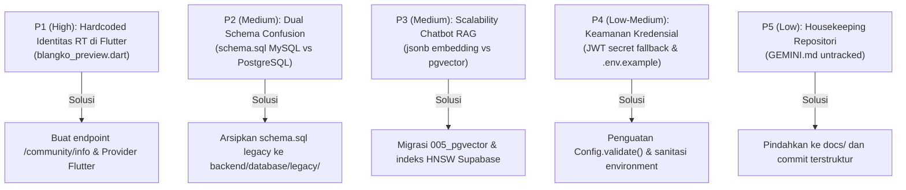

# Action Plan & Remediation Roadmap: RTConnect

**Dokumen Acuan:** [EGM_COMPREHENSIVE_CODEBASE_REVIEW.md](file:///C:/Users/Dhafin/OneDrive/Desktop/Semester%205/Pengembangan%20Perangkat%20Lunak%20(Prak)/RTConnect/docs/audit/EGM_COMPREHENSIVE_CODEBASE_REVIEW.md)  
**Status Target:** Siap Dieksekusi Bertahap (Sprint Roadmap)  

---

## 1. Prioritisasi Masalah & Matriks Dampak



---

## 2. Rincian Rencana Aksi (Phased Implementation)

### Fase 1: Quick Wins & Housekeeping (Estimasi: 1 Sesi Pengerjaan)
Tujuan: Menghilangkan kebingungan developer, mengamankan environment, dan merapikan pohon berkas repositori tanpa mengubah kontrak API klien.

- [ ] **Task 1.1 — Isolasi Legacy MySQL Schema**:
  - Pindahkan file [backend/database/schema.sql](file:///C:/Users/Dhafin/OneDrive/Desktop/Semester%205/Pengembangan%20Perangkat%20Lunak%20(Prak)/RTConnect/backend/database/schema.sql) ke direktori `backend/database/legacy/mysql_schema.sql.bak`.
  - Buat file baru `backend/database/schema.sql` yang berisi petunjuk jelas bahwa skema aktif berada di `backend/database/supabase_sql/000_base_schema.sql`.
- [ ] **Task 1.2 — Housekeeping `GEMINI.md`**:
  - Evaluasi file `GEMINI.md` di root proyek.
  - Pindahkan ke [docs/workflow/GITHUB_ISSUES_WORKFLOW.md](file:///C:/Users/Dhafin/OneDrive/Desktop/Semester%205/Pengembangan%20Perangkat%20Lunak%20(Prak)/RTConnect/docs) atau commit terstruktur agar branch bersih.
- [ ] **Task 1.3 — Penguatan Peringatan Keamanan JWT**:
  - Di [backend/config.py](file:///C:/Users/Dhafin/OneDrive/Desktop/Semester%205/Pengembangan%20Perangkat%20Lunak%20(Prak)/RTConnect/backend/config.py), tambahkan log warning `[SECURITY WARNING] Using local fallback JWT secret` saat startup jika `JWT_SECRET` tidak disuplai melalui file `.env`.

---

### Fase 2: Dynamic Community Configuration (Backend + Flutter Sync)
Tujuan: Menghapus seluruh hardcoded value pada klien mobile dan menyelaraskannya dengan data terpusat di backend.

- [ ] **Task 2.1 — Implementasi Endpoint `/api/v1/community/info` di Backend**:
  - Buat handler di `backend/routes/auth_routes.py` atau blueprint baru `community_bp`:
    ```python
    @app.route('/api/v1/community/info', methods=['GET'])
    def get_community_info():
        return jsonify({
            'success': True,
            'message': 'Informasi wilayah RT',
            'data': {
                'rt_number': Config.RT_NUMBER,
                'rw_number': Config.RW_NUMBER,
                'rt_area': Config.RT_AREA,
                'kelurahan': Config.RT_KELURAHAN,
                'kecamatan': Config.RT_KECAMATAN,
                'kabupaten': Config.RT_KABUPATEN,
                'ketua_rt': Config.RT_NAME,
                'kota_ttd': Config.RT_SIGNING_LOCATION,
                'whatsapp_eskalasi': Config.RT_WHATSAPP_NUMBER
            }
        }), 200
    ```
- [ ] **Task 2.2 — Integrasi ke Flutter Client**:
  - Tambahkan konstanta `ApiEndpoints.communityInfo` di `frontend/lib/core/network/api_endpoints.dart`.
  - Buat model `CommunityInfoEntity` dan repository helper.
  - Refaktor kelas `SuratIdentitas` di [frontend/lib/features/letters/presentation/widgets/blangko_preview.dart](file:///C:/Users/Dhafin/OneDrive/Desktop/Semester%205/Pengembangan%20Perangkat%20Lunak%20(Prak)/RTConnect/frontend/lib/features/letters/presentation/widgets/blangko_preview.dart#L6-L13) agar menerima parameter data dinamis dari state aplikasi.

---

### Fase 3: Modernisasi RAG & Basis Data (Scalability Engine)
Tujuan: Mempersiapkan chatbot TanyaRT agar mampu mengindeks regulasi dalam skala besar dengan latensi pencarian yang rendah.

- [ ] **Task 3.1 — DDL Migrasi Ekstensi `pgvector`**:
  - Buat file migrasi `backend/database/supabase_sql/005_pgvector.sql`:
    ```sql
    CREATE EXTENSION IF NOT EXISTS vector;
    ALTER TABLE public.knowledgechunk ALTER COLUMN embedding_vector TYPE vector(768) USING NULL;
    CREATE INDEX IF NOT EXISTS idx_knowledgechunk_vector ON public.knowledgechunk USING hnsw (embedding_vector vector_cosine_ops);
    ```
- [ ] **Task 3.2 — Skrip Pembantu Embeddings**:
  - Tambahkan fungsi embedding teks menggunakan model `text-embedding-004` (Google GenAI) saat RT mengunggah dokumen baru.
- [ ] **Task 3.3 — Optimasi Query RAG di `rag_service.py`**:
  - Gunakan query PostgreSQL langsung `SELECT chunk_id, isi_chunk, 1 - (embedding_vector <=> %s) AS cosine_similarity FROM knowledgechunk ORDER BY cosine_similarity DESC LIMIT 3` sebelum menerapkan aturan penalti/boost lokal.

---

## 3. Checklist Eksekusi & Kriteria Sukses

| Item Verifikasi | Kriteria Keberhasilan | Pengujian |
|---|---|---|
| **Pembersihan Skema Legacy** | Tidak ada file MySQL aktif di `backend/database/` yang bertentangan dengan Supabase | `git status` & inspeksi file |
| **Endpoint Community Info** | Endpoint mengembalikan status 200 dengan payload JSON lengkap | `curl /api/v1/community/info` atau unit test API |
| **Refaktor Blangko Preview** | Nama Ketua RT & identitas wilayah di preview mobile berubah dinamis mengikuti `.env` | Run Flutter widget test |
| **Regresi BDD** | Seluruh 7 skenario Gherkin (Sprint 1 & Sprint 2) tetap berstatus PASS | `behave features/` |
