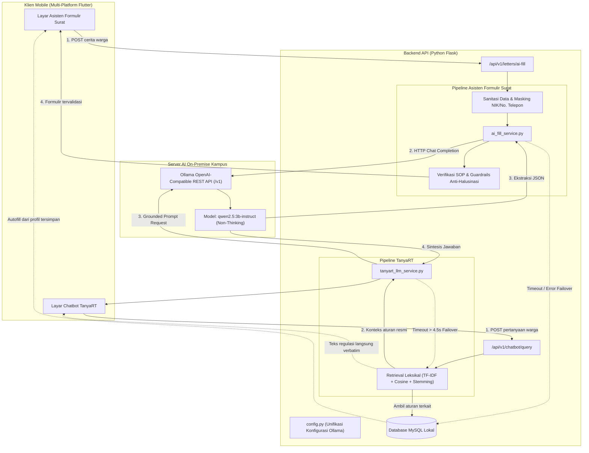
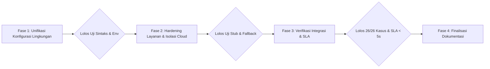

# Migrasi Penuh Layanan AI RTConnect ke Server Kampus (Ollama On-Premise)

* **Author:** Dhafin-dev
* **Status:** Approved & Implementation-Ready
* **Date:** 2026-11-25
* **Version:** 1.0.0

---

## Overview

Dokumen desain teknis ini menetapkan arsitektur dan spesifikasi implementasi migrasi 100% fungsionalitas Artificial Intelligence (AI) pada sistem administrasi RTConnect dari penyedia cloud komersial pihak ketiga (Google Gemini API dan OpenAI API) ke server mandiri berbasis **Ollama** di jaringan lokal/kampus. Sistem ini mencakup dua layanan utama:
1. **Asisten Pengisian Formulir Surat Warga** (`backend/services/ai_fill_service.py`): Mengekstrak jenis surat, tujuan, dan keperluan dari narasi cerita warga secara terstruktur.
2. **Asisten Regulasi TanyaRT** (`backend/services/tanyart_llm_service.py`): Menyintesis jawaban tanya-jawab seputar aturan dan administrasi lingkungan rukun tetangga dengan rujukan dokumen resmi terverifikasi.

## The Problem

Sebelum migrasi ini, arsitektur AI pada RTConnect memiliki kerentanan dan ketergantungan kritis:

1. **Kedaulatan dan Privasi Data Warga (UU PDP No. 27/2022)**: Pengajuan surat dan konsultasi warga memproses informasi kependudukan sensitif. Mengirimkan narasi cerita pengajuan warga ke cloud pihak ketiga di luar negeri menghadirkan risiko kepatuhan hukum privasi dan potensi kebocoran data.
2. **Ketergantungan Kuota dan Biaya Operasional**: Ketergantungan pada kuota gratis Google Gemini API berisiko menimbulkan penolakan layanan akibat lonjakan kuota (*quota exhaustion* HTTP 429), sementara model komersial membebankan biaya variabel yang membebani kas operasional rukun tetangga.
3. **Fragmentasi dan Kerapuhan Layanan**: Modul persuratan sempat mendukung server lokal secara parsial, tetapi modul chatbot TanyaRT terikat secara eksklusif pada SDK Gemini, dan modul pencarian semantik mengandalkan OpenAI. Hal ini menciptakan arsitektur ganda yang rentan terhadap kegagalan jaringan eksternal.

Solusi yang ditetapkan adalah mengalihkan seluruh pemrosesan kecerdasan buatan ke server Ollama kampus (menggunakan model instruksi ringkas non-penalaran `qwen2.5:3b-instruct` pada IP `192.168.88.237` atau domain Cloudflare Access), mematikan seluruh alur keluar (*outbound egress*) cloud eksternal, dan mengoperasikan pencarian TanyaRT pada algoritma leksikal deterministik tanpa biaya API.

## Goals

* **Kemandirian Infrastruktur 100%**: Mengeliminasi seluruh ketergantungan pemanggilan keluar (*outbound egress*) ke Google Gemini API dan OpenAI API.
* **Perlindungan Data Kependudukan**: Memastikan 100% data narasi warga dan kueri administrasi diproses di dalam perimeter server lokal/kampus.
* **Kepatuhan Batas Waktu Respon (SLA NFR 5.1)**: Memastikan TanyaRT menjawab dalam batas waktu ketat maksimal 5.0 detik (*Non-Functional Requirement 5.1: Latensi Respon Chatbot*) dengan fallback deterministik berbasis kutipan dokumen resmi jika Ollama melampaui batas waktu inferensi (4.5 detik).
* **Penyelarasan Autentikasi Jaringan**: Menyelaraskan modul asisten formulir persuratan dan TanyaRT agar mendukung header Cloudflare Access (`CF-Access-Client-Id` dan `CF-Access-Client-Secret`) secara konsisten jika diakses melalui rute publik kampus.
* **Resiliensi Pengisian Formulir**: Menjamin bahwa jika server Ollama sibuk atau tidak dapat diakses, sistem secara otomatis mengisi formulir dari data profil tersimpan warga pada database MySQL lokal (`sumber: 'tersimpan'`) tanpa menampilkan pesan error yang memblokir proses pengajuan surat.

## Non-Goals

* Menyediakan atau menginstal klaster server Ollama baru dari nol (memanfaatkan infrastruktur server kampus yang sudah beroperasi).
* Menggunakan model penalaran berukuran besar (*reasoning models* seperti DeepSeek-R1 atau Qwen-Thinking) yang membutuhkan waktu komputasi > 20 detik per kueri.
* Menjalankan model embedding vektor baru di server Ollama (TanyaRT dioptimasi menggunakan pencarian leksikal TF-IDF + stemming bahasa Indonesia yang terbukti lulus uji regresi 26 kasus).
* Mengubah skema database MySQL lokal yang sudah berjalan pada repositori (`backend/database/`).

## Deployment Boundaries & Network Topology

Batasan topologi jaringan ditetapkan secara tegas untuk mencegah kerancuan antara lalu lintas klien dan backend:

1. **Klien Mobile (Aplikasi Flutter)**: Klien mobile warga berkomunikasi **hanya** dengan backend Flask melalui endpoint HTTPS resmi (`/api/v1/letters/ai-fill` dan `/api/v1/chatbot/query`). Klien mobile **tidak pernah** terhubung langsung ke server Ollama kampus.
2. **Backend Flask (Server Orchestrator)**: Backend beroperasi pada lingkungan hosting tetap. Egress jaringan backend ke Ollama ditentukan sepenuhnya oleh variabel lingkungan `LLM_BASE_URL`:
   * **Lingkungan Intranet / Jaringan Kampus**: Menggunakan IP LAN langsung `http://192.168.88.237:11434/v1` (100% data localization murni on-premise).
   * **Lingkungan Eksternal / Cloud Hosting (Coolify)**: Menggunakan gateway Cloudflare Access `https://ollama.ebruar.my.id/v1` yang dilindungi *Service Token* (`CF-Access-Client-Id` dan `CF-Access-Client-Secret`) melalui tunnel terenkripsi.
3. Klien mobile warga tetap dapat mengajukan surat dan bertanya ke TanyaRT dari mana saja (baik dari WiFi kampus, jaringan seluler, maupun internet rumah) tanpa memerlukan perubahan konfigurasi jaringan di sisi perangkat warga.

## Critical User Journeys (CUJs)

### CUJ 1: Warga Mengajukan Surat dengan Bantuan Asisten AI (Ollama Form Fill)
* **Given**: Warga telah login di aplikasi Flutter RTConnect, dan backend terkonfigurasi ke server Ollama (`LLM_BASE_URL`).
* **When**: Warga mengetik cerita kebutuhan surat pada layar asisten AI: *"Saya butuh surat domisili untuk keperluan lamar kerja di PT Maju Jaya"*.
* **Then**: Backend memanggil Ollama via rute `/v1/chat/completions`, mengekstrak jenis surat `SKD` (Surat Keterangan Domisili) dan keperluan *"Melamar pekerjaan di PT Maju Jaya"*, memvalidasi data via guardrails SOP, dan menampilkan pratinjau formulir terisi otomatis kepada warga dalam waktu < 8.0 detik.

### CUJ 2: Warga Bertanya Prosedur Administrasi ke TanyaRT (Ollama Grounded QA)
* **Given**: Warga membuka tab TanyaRT pada aplikasi.
* **When**: Warga mengirim pertanyaan: *"Berapa iuran kas lingkungan RT 04?"*.
* **Then**: Backend mengambil potongan dokumen resmi via retrieval leksikal, mengirim prompt ter-grounding ke Ollama dengan batas waktu inferensi 4.5 detik, dan mengembalikan jawaban ringkas (2-4 kalimat) bersertakan nomor rujukan resmi pedoman RT (`RTC-014`) dalam waktu < 5.0 detik (SLA NFR 5.1).

### CUJ 3: Penanganan Kegagalan Server Kampus (Graceful Fail-Soft)
* **Given**: Server Ollama kampus sedang mengalami pemadaman atau antrean padat yang memicu timeout.
* **When**: Warga mengajukan surat atau bertanya ke TanyaRT.
* **Then**: 
  * Pada TanyaRT: Sistem memotong pemanggilan AI pada detik ke-4.5 dan langsung menampilkan kutipan resmi dokumen pedoman RT dari indeks leksikal lokal tanpa error.
  * Pada Formulir Surat: Sistem mengisi formulir menggunakan data profil akun kependudukan warga dari database MySQL lokal (`sumber: 'tersimpan'`) dan memberi tahu warga secara ramah untuk melengkapi sisa isian manual.

---

## Technical Plan (Architecture)

### 1. Arsitektur Komponen & Diagram Alur Data

Perubahan arsitektur mengisolasi seluruh komputasi AI ke dalam perimeter server kampus. Backend Flask bertindak sebagai *orchestrator*, gerbang sanitasi keamanan, serta pengendali *fail-soft*.



### 2. Perbandingan Spesifikasi Antarmuka Endpoint AI

| Parameter | Asisten Formulir Surat (`ai_fill_service`) | Asisten Regulasi TanyaRT (`tanyart_llm_service`) |
| :--- | :--- | :--- |
| **Endpoint Target** | `${Config.LLM_BASE_URL}/chat/completions` | `${Config.TANYART_LLM_BASE_URL}/chat/completions` |
| **Metode HTTP** | `POST` | `POST` |
| **Model Default** | `qwen2.5:3b-instruct` | `qwen2.5:3b-instruct` |
| **Format Respon** | `{"type": "json_object"}` (Strict JSON) | Plain Text (2–4 Kalimat Padat) |
| **Batas Waktu (Timeout)** | `8.0` detik (`Config.LLM_TIMEOUT_SECONDS`) | `4.5` detik (`Config.TANYART_LLM_TIMEOUT`) |
| **Token Maksimum** | Dynamic / Default Model | `300` tokens |
| **Header Khusus** | `CF-Access-*` (Bila domain Cloudflare) | `CF-Access-*` (Bila domain Cloudflare) |
| **Mekanisme Fallback** | Snapshot profil warga MySQL (`sumber: 'tersimpan'`) | Kutipan verbatim regulasi offline (`RTC-XXX`) |

### 3. Protokol Komunikasi & Spesifikasi Permintaan

#### A. Format Permintaan Asisten Formulir Surat (`ai_fill_service.py`)
* **Endpoint Target**: `${Config.LLM_BASE_URL}/chat/completions` (normalisasi memastikan akhiran rute `/v1/chat/completions`).
* **Headers**:
  ```http
  Content-Type: application/json
  Authorization: Bearer ollama
  CF-Access-Client-Id: <CF_CLIENT_ID>        (kondisional bila rute ke ollama.ebruar.my.id)
  CF-Access-Client-Secret: <CF_CLIENT_SECRET> (kondisional bila rute ke ollama.ebruar.my.id)
  ```
* **Payload JSON**:
  ```json
  {
    "model": "qwen2.5:3b-instruct",
    "messages": [
      {"role": "system", "content": "<SYSTEM_PROMPT_EKSTRAKSI_ISIAN_SURAT>"},
      {"role": "user", "content": "<<<NONCE_DELIMITER>>>\n<CERITA_WARGA_TERMASKING>\n<<<NONCE_DELIMITER>>>"}
    ],
    "temperature": 0.2,
    "response_format": {"type": "json_object"},
    "stream": false
  }
  ```

#### B. Format Permintaan TanyaRT (`tanyart_llm_service.py`)
* **Endpoint Target**: `${Config.TANYART_LLM_BASE_URL}/chat/completions`
* **Headers**:
  ```http
  Content-Type: application/json
  Authorization: Bearer ollama
  CF-Access-Client-Id: <CF_CLIENT_ID>        (kondisional bila rute ke ollama.ebruar.my.id)
  CF-Access-Client-Secret: <CF_CLIENT_SECRET> (kondisional bila rute ke ollama.ebruar.my.id)
  ```
* **Payload JSON**:
  ```json
  {
    "model": "qwen2.5:3b-instruct",
    "messages": [
      {"role": "system", "content": "<TANYART_SYSTEM_PROMPT_STRICT_GROUNDING>"},
      {"role": "user", "content": "{\"pertanyaan\": \"...\", \"dokumen\": \"...\"}"}
    ],
    "temperature": 0.2,
    "max_tokens": 300,
    "stream": false
  }
  ```

### 4. Manajemen Konkurensi & Resiliensi Fail-Soft (Tanpa Antrean Eksternal)

Untuk mencegah beban berlebih pada server kampus yang digunakan bersama:
1. **Rejection of Distributed Message Brokers (Anti-YAGNI)**: Penambahan broker pesan eksternal seperti Redis/Celery ditolak karena menambah kompleksitas dependensi infrastruktur pada aplikasi skala rukun tetangga.
2. **Backpressure Native Ollama**: Mengandalkan kemampuan antrean native daemon Ollama (`OLLAMA_NUM_PARALLEL`). Jika antrean server penuh, Ollama mengembalikan kode status HTTP 429 atau 503.
3. **Penyangga Akuisisi Terbatas**: Pada `tanyart_llm_service.py`, penyangga thread menunggu maksimal 0.8 detik (`_SLOTS.acquire(timeout=0.8)`). Jika slot tetap penuh, sistem langsung mengaktifkan fallback leksikal tanpa menunggu lama.
4. **Pembersihan Tag Penalaran Model**: Seluruh luaran model dibersihkan dari tag penalaran internal menggunakan regex sanitasi (`<think>.*?</think>`) untuk mengantisipasi perilaku model turunan.

### 5. Kebijakan Kedaulatan Data Lokal & Invarian Fail-Safe

* **Invarian 1 (Zero Outbound Egress)**: Seluruh pemanggilan inferensi AI keluar (*outbound cloud egress*) ke Google Gemini API dan OpenAI API diblokir secara permanen di tingkat konfigurasi runtime. Dependensi modul dibersihkan dari pemanggilan cloud aktif.
* **Invarian 2 (Fail-Safe Data Kependudukan)**: Jika inferensi Ollama mengalami timeout, gagal parsing JSON, atau server mati, `ai_fill_service.py` mengambil data profil warga dari database MySQL lokal (`sumber: 'tersimpan'`). Warga tetap dapat mengajukan surat secara manual tanpa kendala.
* **Invarian 3 (Grounded Information Integrity)**: Jawaban TanyaRT wajib bersumber dari `knowledge_chunks` database lokal. Jika model menghasilkan halusinasi atau mengalami timeout (> 4.5 detik), sistem mengembalikan teks kutipan peraturan asli secara verbatim disertai identitas dokumen sumber (misal: `Pedoman RT (RTC-014)`).
* **Invarian 4 (Defensive Delimiter Sanitization)**: Input cerita warga disanitasi dari karakter delimiter sebelum diinterpolasi ke dalam prompt menggunakan nonce acak (UUID4) untuk mencegah injeksi prompt.

---

## Risks & Mitigations

| Risiko / Modus Kegagalan | Dampak | Probabilitas | Rencana Mitigasi Teknis |
| :--- | :--- | :---: | :--- |
| **Server Kampus Padam / Jaringan Terputus** | Panggilan AI gagal total (HTTP Connection Refused / Timeout). | Sedang | **Fail-Soft Instan**: TanyaRT langsung menampilkan teks regulasi leksikal verbatim; formulir persuratan otomatis terisi data profil MySQL tersimpan (`sumber: 'tersimpan'`). |
| **GPU VRAM Starvation / Antrean Padat** | Waktu inferensi melambat drastis (> 10 detik). | Sedang | **Strict Timeout Cutoff**: TanyaRT memutus panggilan pada detik ke-4.5 (menjaga SLA total < 5.0s); persuratan memutus panggilan pada detik ke-8.0. |
| **Model Halusinasi Mengubah Data Warga** | Nama, NIK, atau identitas warga salah terekstraksi. | Rendah | **Guardrail Isolasi Identitas**: Data sensitif warga (NIK, Nama, Agama) tidak pernah diekstrak oleh LLM; data ini diambil murni dari snapshot akun terautentikasi di database MySQL. |
| **Prompt Injection / Delimiter Collision** | Warga memasukkan instruksi manipulasi prompt pada cerita pengajuan surat. | Rendah | **Sanitasi Nonce**: Pembungkusan cerita warga menggunakan nonce acak (UUID4) unik per permintaan, pembersihan tag pembatas dari teks input, dan validasi skema JSON ketat oleh `ai_guardrails.py`. |
| **Kebocoran Data Kependudukan (UU PDP)** | Teks pengajuan warga bocor ke server pihak ketiga di luar negeri. | Nol | **Perimeter Tertutup**: 100% panggilan AI diarahkan ke endpoint lokal on-premise kampus (`192.168.88.237`), seluruh kunci API cloud dikosongkan. |

---

## Alternatives Considered

### Matriks Evaluasi Alternatif Arsitektur

| Kriteria Evaluasi | Alternatif Terpilih: Full Ollama On-Premise | Alternatif A: Hibrida (Ollama + Backup Gemini Cloud) | Alternatif B: Model Parameter Besar (14B/70B) | Alternatif C: Model Embedding Vektor Mandiri |
| :--- | :---: | :---: | :---: | :---: |
| **Kedaulatan Data Warga (UU PDP)** | **100% Aman (Lokal)** | Berisiko saat failover | **100% Aman (Lokal)** | **100% Aman (Lokal)** |
| **Biaya Operasional API** | **Rp 0 (Nol Biaya)** | Variabel (Berbayar) | **Rp 0 (Nol Biaya)** | **Rp 0 (Nol Biaya)** |
| **Latensi Inferensi Rata-rata** | **1.5 – 3.5 detik** | 1.5 – 3.5 detik | 15.0 – 45.0 detik | 4.0 – 8.0 detik (Kueri ganda) |
| **Kebutuhan VRAM GPU** | **< 4 GB VRAM** | < 4 GB VRAM | > 16 GB – 40 GB VRAM | ~8 GB VRAM |
| **Kepatuhan SLA TanyaRT (<5s)** | **Lolos (< 5.0 detik)** | Lolos | **Gagal (> 15 detik)** | Berisiko melampaui SLA |

### Analisis Rinci Alternatif

#### Alternatif A: Arsitektur Hibrida (Ollama Utama + Google Gemini API sebagai Cadangan Otomatis)
* **Kelebihan**: Menghadirkan tingkat ketersediaan tinggi saat server kampus mati.
* **Kekurangan**: Melanggar prinsip privasi UU PDP No. 27/2022 karena data narasi warga tetap berisiko dikirim ke cloud saat terjadi failover, membutuhkan pemeliharaan dua SDK berbeda, dan tetap bergantung pada API key komersial.
* **Alasan Penolakan**: Prinsip kedaulatan data warga RT 04 tidak dapat dikompromikan. Keberadaan jalur failover otomatis ke cloud membuka celah kebocoran data kependudukan secara tidak sengaja saat jaringan kampus berfluktuasi. Ketersediaan layanan saat server mati cukup diatasi dengan fallback data profil tersimpan pada database MySQL lokal.

#### Alternatif B: Penggunaan Model Parameter Besar (Llama-3.1 70B atau Qwen-2.5 14B)
* **Kelebihan**: Kapasitas pemahaman konteks dan fleksibilitas bahasa gaul lebih mendalam.
* **Kekurangan**: Membutuhkan alokasi GPU VRAM masif (16 GB – 40 GB). Server kampus digunakan bersama dan berisiko tinggi memicu *Out Of Memory* (OOM) serta latensi respon 15 hingga 45 detik.
* **Alasan Penolakan**: Melanggar SLA TanyaRT (< 5.0 detik). Model instruksi ringkas 3B parameter (`qwen2.5:3b-instruct`) adalah titik ekuilibrium terbaik antara kecepatan inferensi (1.5–3.5 detik) dan efisiensi memori (< 4 GB VRAM).

#### Alternatif C: Menjalankan Model Embedding Vektor Mandiri di Ollama (bge-m3 / nomic-embed-text)
* **Kelebihan**: Menghadirkan pencarian semantik vektor murni secara on-premise tanpa OpenAI API.
* **Kekurangan**: Menimbulkan kueri ganda ke GPU kampus (satu kueri embedding vektor dan satu kueri sintesis LLM), melipatgandakan latensi awal serta menambah beban tabel kalkulasi vektor pada database.
* **Alasan Penolakan**: Evaluasi empiris pada repositori membuktikan bahwa algoritma pencarian leksikal deterministik (TF-IDF + Cosine Similarity + Stemming Bahasa Indonesia pada `backend/services/rag_service.py`) berhasil lulus 100% dari 26 kasus uji regresi TanyaRT tanpa memerlukan kueri embedding eksternal.

---

## Non-Functional Requirements (NFR)

### 1. Keamanan & Perlindungan Data (Security & Privacy)
* **Kedaulatan Data Lokal (Data Localization)**: 100% lalu lintas teks cerita dan pertanyaan warga hanya berputar antara klien, backend Flask, dan server Ollama kampus (`192.168.88.237` atau tunnel Cloudflare Access terenkripsi).
* **Masking Sebelum Inferensi**: Nomor identitas kependudukan (NIK/KK) dan nomor telepon warga wajib disamarkan secara otomatis oleh fungsi `mask_sensitive()` sebelum dikirimkan ke model AI.
* **Autentikasi Service Token**: Jika rute mengarah ke domain Cloudflare Access (`ollama.ebruar.my.id`), permintaan wajib menyertakan `CF-Access-Client-Id` dan `CF-Access-Client-Secret`.

### 2. Kinerja & Batas Waktu Respon (Performance & Latency)
* **SLA Respon TanyaRT (NFR 5.1)**: Waktu total pemrosesan pertanyaan warga hingga jawaban tampil di aplikasi maksimal `5.0 detik`. Budget pemanggilan inferensi Ollama dibatasi ketat maksimal `4.5 detik` (`TANYART_LLM_TIMEOUT=4.5`), menyisakan 500 ms untuk retrieval leksikal dan transmisi jaringan.
* **SLA Asisten Formulir Surat**: Waktu pemrosesan formulir pengajuan surat maksimal `8.0 detik` (`LLM_TIMEOUT_SECONDS=8.0`).

### 3. Kompatibilitas & Kemudahan Rollback
* **Kompatibilitas Backward**: Variabel konfigurasi dirancang adaptif (`TANYART_LLM_BASE_URL` otomatis mewarisi `LLM_BASE_URL` bila tidak didefinisikan secara khusus).
* **Rollback Terkendali**: Jika server kampus mengalami gangguan permanen, pengembang cukup mengalihkan URL pada `.env` tanpa merombak arsitektur inti program.

---

## Detailed Implementation Plan

Rencana implementasi dibagi menjadi empat fase bertahap dengan batas uji kestabilan (*checkpoints*):



### Fase 1: Unifikasi Konfigurasi Lingkungan

#### Berkas yang Dimodifikasi:
1. **`backend/.env` (Modify)**
   * **Baseline Terverifikasi**: Konfigurasi `LLM_BASE_URL=http://192.168.88.237:11434/v1` dan `TANYART_LLM_BASE_URL` sudah terpasang.
   * **Tugas Delta Baru**:
     - Atur `TANYART_LLM_TIMEOUT=4.5` (menyesuaikan budget SLA).
     - Atur `LLM_TIMEOUT_SECONDS=8.0` (meredam *freeze* pada formulir).
     - Pastikan `GEMINI_API_KEY=""` dan `OPENAI_API_KEY=""` disetel string kosong eksplisit.
2. **`backend/.env.example` (Modify)**
   * **Tugas Delta Baru**: Masukkan blok konfigurasi template berikut secara literal:
     ```bash
     # --- Konfigurasi Ollama On-Premise Kampus ---
     LLM_BASE_URL=http://192.168.88.237:11434/v1
     LLM_API_KEY=ollama
     LLM_MODEL=qwen2.5:3b-instruct
     LLM_TIMEOUT_SECONDS=8.0

     # Konfigurasi TanyaRT (otomatis mewarisi LLM_* bila dikosongkan)
     TANYART_LLM_BASE_URL=http://192.168.88.237:11434/v1
     TANYART_LLM_MODEL=qwen2.5:3b-instruct
     TANYART_LLM_TIMEOUT=4.5

     # Service Token Cloudflare Access (diisi bila menggunakan rute publik kampus)
     CF_CLIENT_ID=
     CF_CLIENT_SECRET=

     # Kunci Cloud Eksternal (kosongkan untuk mengaktifkan Full On-Premise 100%)
     GEMINI_API_KEY=
     OPENAI_API_KEY=
     ```
3. **`backend/config.py` (Verify & Modify)**
   * **Baseline Terverifikasi**: Fallback `TANYART_LLM_*` ke `LLM_*` dan pembacaan `CF_CLIENT_*` sudah ada di baris 91–100.
   * **Tugas Delta Baru**: Setel nilai default `LLM_TIMEOUT_SECONDS = float(os.getenv('LLM_TIMEOUT_SECONDS', '8.0'))`.
* **Checkpoint Fase 1**: Jalankan `python -m py_compile backend/config.py` dari root repositori. *Kriteria lolos:* Kode keluar 0 (*exit code 0*).

---

### Fase 2: Hardening Layanan & Pemutusan Total Alur Cloud

#### Berkas yang Dimodifikasi:
1. **`backend/services/ai_fill_service.py` (Modify)**
   * **Baseline Terverifikasi**: Normalisasi URL `/v1/chat/completions` dan injeksi header Cloudflare sudah terpasang di baris 168–187.
   * **Tugas Delta Baru**:
     - Bersihkan fungsi `_call_gemini()` agar tidak memanggil SDK `google.genai` eksternal saat `LLM_BASE_URL` aktif; jika panggilan Ollama gagal atau timeout, fungsi langsung membangkitkan `RuntimeError("Ollama failed")` sehingga `suggest_application()` beralih ke data profil tersimpan MySQL (`sumber: 'tersimpan'`).
     - Bungkus impor `google.genai` secara defensif atau bersihkan dari alur runtime aktif.
     - Terapkan sanitasi pembatas prompt dengan UUID4 nonce.
2. **`backend/services/tanyart_llm_service.py` (Modify)**
   * **Baseline Terverifikasi**: Whitelist `192.168.88.237` dan `LLM_BASE_URL` fallback sudah aktif di baris 43–48.
   * **Tugas Delta Baru**:
     - Ganti pembacaan kamus `os.environ["CF_CLIENT_ID"]` pada baris 69–70 dengan akses aman `getattr(Config, 'CF_CLIENT_ID', None)` atau `os.environ.get("CF_CLIENT_ID")` untuk mencegah `KeyError`.
     - Validasi endpoint target sebagai format URL standar tanpa ketergantungan *string check* statis.
3. **`backend/services/semantic_embedding_service.py` (Verify)**
   * **Baseline Terverifikasi**: Fungsi `is_embedding_configured()` tetap mengembalikan `False` untuk memastikan pencarian leksikal deterministik berjalan 100%.
* **Checkpoint Fase 2**: Jalankan kompilasi sintaks: `python -m py_compile backend/services/ai_fill_service.py backend/services/tanyart_llm_service.py backend/services/semantic_embedding_service.py`. *Kriteria lolos:* Tidak ada error sintaksis.

---

### Fase 3: Pengujian Integrasi, Regresi & Verifikasi SLA

Jalankan rangkaian pengujian otomatis dari root repositori:
1. **Uji Fungsional & Regresi TanyaRT**:
   * Perintah: `backend/.venv/Scripts/python.exe backend/test_tanyart_full.py`
   * *Target Keberhasilan:* 26/26 kasus regresi leksikal lulus 100% (`TEST-01`), isolasi sesi warga lulus (`TEST-04`), pencegahan *prompt injection* lulus (`TEST-05`).
2. **Uji Pengukuran Latensi & Kepatuhan SLA NFR 5.1**:
   * Perintah: `backend/.venv/Scripts/python.exe backend/ukur_latensi_lengkap.py`
   * *Target Keberhasilan:* Waktu eksekusi rata-rata retrieval leksikal < 50 ms; total siklus inferensi terpotong pada batas 4.5 detik saat server offline tanpa melanggar batas 5.0 detik.
3. **Uji Unit & Fallback Asisten Formulir Surat (`ai_fill_service.py`)**:
   * Skenario 1 (Ekstraksi Berhasil): Panggilan mock Ollama mengembalikan jenis surat dan keperluan valid.
   * Skenario 2 (Fail-Soft Fallback): Panggilan Ollama timeout memicu fallback profil kependudukan dari MySQL (`sumber: 'tersimpan'`).
   * Skenario 3 (Header Cloudflare): Permintaan ke `ollama.ebruar.my.id` menyertakan `CF-Access-Client-Id` dan `CF-Access-Client-Secret`.
* **Checkpoint Fase 3**: Seluruh suite pengujian lolos tanpa kegagalan regresi.

---

### Fase 4: Finalisasi Dokumentasi & Jejak Keputusan (Provenance)

1. **`concepts_brief.md` (Update)**: Memperbarui ringkasan ideasi awal dengan menyelaraskan parameter timeout (4.5s/8.0s) dan mitigasi risiko.
2. **`docs/designs/SITEMAP.md` (Update)**: Memperbarui status dokumen dari `Draft` menjadi `Approved & Implementation-Ready`.

---

## Verification Plan

Rangkaian perintah verifikasi wajib dieksekusi secara konsisten dari root repositori:

```bash
# 1. Pemeriksaan integritas sintaksis seluruh modul backend terkait
backend/.venv/Scripts/python.exe -m py_compile backend/config.py backend/services/ai_fill_service.py backend/services/tanyart_llm_service.py backend/services/semantic_embedding_service.py

# 2. Eksekusi pengujian fungsional dan isolasi keamanan TanyaRT (26 kasus)
backend/.venv/Scripts/python.exe backend/test_tanyart_full.py

# 3. Eksekusi pengukuran latensi leksikal dan verifikasi batas SLA NFR 5.1 (< 5.0 detik)
backend/.venv/Scripts/python.exe backend/ukur_latensi_lengkap.py
```

*Kriteria Keberhasilan Final:* Seluruh perintah menghasilkan status sukses (*exit code 0*), tidak ada kueri keluar ke endpoint Google/OpenAI, dan berkas CSV hasil audit latensi tercatat rapi pada `docs/audit/bukti/`.

---

*Drafted & Reviewed with EGM (Elephant-Goldfish Model)*
