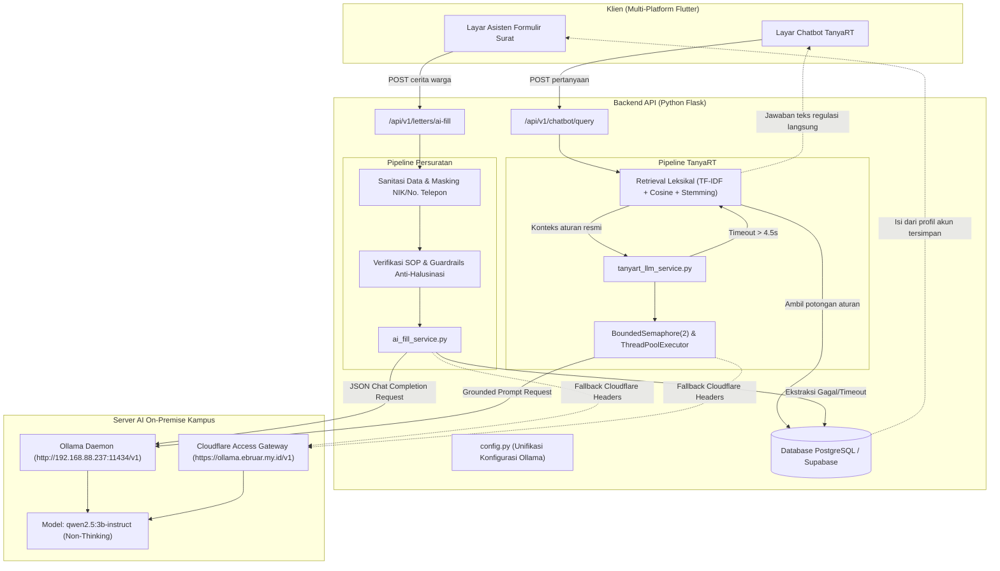

# Migrasi Penuh Layanan AI RTConnect ke Server Kampus (Ollama On-Premise)

* **Author:** Dhafin-dev
* **Status:** Draft
* **Date:** 2026-11-25

--------------------------------------------------------------------------------

## Overview

Dokumen desain teknis ini menetapkan arsitektur dan spesifikasi implementasi migrasi 100% fungsionalitas Artificial Intelligence (AI) pada sistem administrasi RTConnect dari penyedia cloud eksternal komersial (Google Gemini API dan OpenAI API) ke server mandiri berbasis **Ollama** di jaringan lokal/kampus. Sistem ini mencakup dua layanan utama: asisten pengisian otomatis formulir pengajuan surat warga (`ai_fill_service`) dan asisten tanya-jawab regulasi lingkungan TanyaRT (`tanyart_llm_service`).

## The Problem

Sebelum migrasi ini, arsitektur AI pada RTConnect memiliki kerentanan dan ketergantungan yang signifikan:

1. **Kedaulatan dan Privasi Data Warga (UU PDP No. 27/2022)**: Pengajuan surat dan konsultasi warga memproses informasi kependudukan. Mengirimkan narasi cerita pengajuan warga ke cloud pihak ketiga di luar negeri menghadirkan risiko kepatuhan hukum privasi dan kebocoran data.
2. **Ketergantungan Kuota dan Biaya Operasional**: Ketergantungan pada kuota gratis Google Gemini API berisiko menimbulkan *quota exhaustion* (HTTP 429) saat penggunaan tinggi, sementara model berbayar membebankan biaya variabel yang tidak berkelanjutan untuk kas rukun tetangga.
3. **Fragmentasi Layanan**: Modul persuratan sempat mendukung server lokal secara parsial, tetapi modul chatbot TanyaRT terkunci mati pada SDK Gemini, dan modul pencarian semantik mengandalkan OpenAI. Hal ini menciptakan arsitektur ganda yang rentan terhadap kegagalan jaringan eksternal.

Solusi yang ditetapkan adalah mengalihkan seluruh pemrosesan kecerdasan buatan ke server Ollama kampus (menggunakan model instruksi ringkas non-penalaran `qwen2.5:3b-instruct` pada IP `192.168.88.237` atau domain Cloudflare Access), mematikan seluruh fallback cloud eksternal, dan mengoperasikan pencarian TanyaRT pada algoritma leksikal deterministik tanpa biaya API.

## Goals

* **Kemandirian Infrastruktur 100%**: Mengeliminasi seluruh ketergantungan pemanggilan keluar (*outbound egress*) ke Google Gemini API dan OpenAI API.
* **Perlindungan Data Kependudukan**: Memastikan 100% data narasi warga dan kueri administrasi diproses di dalam server lokal/kampus.
* **Kepatuhan Batas Waktu Respon (SLA NFR 5.1)**: Memastikan TanyaRT menjawab dalam batas waktu ketat maksimal 5.0 detik dengan fallback deterministik berbasis kutipan dokumen resmi jika Ollama melampaui batas waktu.
* **Penyelarasan Autentikasi Jaringan**: Menyelaraskan modul asisten formulir persuratan agar mendukung header Cloudflare Access (`CF-Access-Client-Id` dan `CF-Access-Client-Secret`) jika diakses melalui rute publik kampus.
* **Resiliensi Pengisian Formulir**: Menjamin bahwa jika server Ollama sibuk atau tidak dapat diakses, sistem secara otomatis mengisi formulir dari data profil tersimpan warga tanpa menampilkan pesan error yang memblokir proses pengajuan surat.

## Non-Goals

* Menyediakan atau menginstal klaster server Ollama baru dari nol (memanfaatkan infrastruktur server kampus yang sudah beroperasi).
* Menggunakan model penalaran berukuran besar (*reasoning models* seperti DeepSeek-R1 atau Qwen-Thinking) yang membutuhkan waktu komputasi >20 detik per kueri.
* Menjalankan model embedding vektor baru di server Ollama (TanyaRT dioptimasi menggunakan pencarian leksikal TF-IDF + stemming bahasa Indonesia yang terbukti lulus uji regresi 26 kasus).
* Mengubah skema database PostgreSQL / Supabase yang sudah berjalan.

## Open Questions

* **Question 1**: Bagaimana stabilitas koneksi IP lokal `192.168.88.237` ketika aplikasi diakses di luar jaringan WiFi kampus (apakah diperlukan mekanisme auto-switch ke domain Cloudflare `ollama.ebruar.my.id`)?
* **Question 2**: Berapa rata-rata latensi inferensi riil `qwen2.5:3b-instruct` pada server kampus saat melayani beberapa kueri formulir secara bersamaan?

## Critical User Journeys (CUJs)

### CUJ 1: Warga Mengajukan Surat dengan Bantuan Asisten AI (Ollama Form Fill)
* **Given**: Warga telah login di aplikasi Flutter RTConnect, dan backend terkonfigurasi ke `LLM_BASE_URL=http://192.168.88.237:11434/v1`.
* **When**: Warga mengetik cerita kebutuhan surat pada layar asisten AI: *"Saya butuh surat domisili untuk keperluan lamar kerja di PT Maju Jaya"*.
* **Then**: Backend memanggil Ollama via rute `/v1/chat/completions`, mengekstrak jenis surat `SKD` dan keperluan `Melamar pekerjaan di PT Maju Jaya`, memvalidasi guardrails data pemohon, dan menampilkan pratinjau formulir terisi otomatis kepada warga.

### CUJ 2: Warga Bertanya Prosedur Administrasi ke TanyaRT (Ollama Grounded QA)
* **Given**: Warga membuka tab TanyaRT pada aplikasi.
* **When**: Warga mengirim pertanyaan: *"Berapa iuran kas lingkungan RT 04?"*.
* **Then**: Backend mengambil potongan dokumen resmi via retrieval leksikal, mengirim prompt ter-grounding ke Ollama, dan mengembalikan jawaban ringkas (2-4 kalimat) bersertakan nomor rujukan resmi pedoman RT dalam waktu < 5.0 detik.

### CUJ 3: Penanganan Kegagalan Server Kampus (Graceful Fallback)
* **Given**: Server Ollama kampus sedang mengalami pemadaman atau antrean padat yang memicu timeout.
* **When**: Warga mengajukan surat atau bertanya ke TanyaRT.
* **Then**: 
  - Pada TanyaRT: Sistem memotong panggilan AI pada detik ke-4.5 dan langsung menampilkan kutipan resmi dokumen pedoman RT tanpa error.
  - Pada Formulir Surat: Sistem mengisi formulir menggunakan data profil akun kependudukan warga yang tersimpan (`sumber: tersimpan`) dan memberi tahu warga secara ramah untuk melengkapi data manual.

--------------------------------------------------------------------------------

## Technical Plan (Architecture)

### 1. Arsitektur Komponen & Diagram Alur Data

Perubahan arsitektur mengisolasi seluruh komputasi AI ke dalam perimeter on-premise lokal/kampus. Backend Flask bertindak sebagai *orchestrator*, gerbang sanitasi keamanan, serta *fail-safe controller*.



### 2. Protokol Komunikasi & Spesifikasi Antarmuka

Kedua layanan berinteraksi dengan Ollama menggunakan antarmuka standar **OpenAI-Compatible REST API** (`/v1/chat/completions`):

#### A. Format Permintaan Asisten Formulir Surat (`ai_fill_service.py`)
* **Endpoint Target**: `${Config.LLM_BASE_URL}/chat/completions` (normalisasi otomatis memastikan akhiran `/v1`).
* **Metode HTTP**: `POST`
* **Headers**:
  ```http
  Content-Type: application/json
  Authorization: Bearer ollama
  CF-Access-Client-Id: <CF_CLIENT_ID>        (kondisional bila rute ke ollama.ebruar.my.id)
  CF-Access-Client-Secret: <CF_CLIENT_SECRET> (kondisional bila rute ke ollama.ebruar.my.id)
  ```
* **Payload JSON**:
  ```json
  {
    "model": "qwen2.5:3b-instruct",
    "messages": [
      {"role": "system", "content": "<SYSTEM_PROMPT_EKSTRAKSI>"},
      {"role": "user", "content": "<PROMPT_BERDELIMITER_ACAK_DAN_DATA_WARGA>"}
    ],
    "temperature": 0.2,
    "response_format": {"type": "json_object"},
    "stream": false
  }
  ```
* **Batas Waktu (Timeout)**: `15.0` detik (`Config.LLM_TIMEOUT_SECONDS`).

#### B. Format Permintaan TanyaRT (`tanyart_llm_service.py`)
* **Endpoint Target**: `${Config.TANYART_LLM_BASE_URL}/chat/completions`
* **Metode HTTP**: `POST`
* **Payload JSON**:
  ```json
  {
    "model": "qwen2.5:3b-instruct",
    "messages": [
      {"role": "system", "content": "<TANYART_SYSTEM_PROMPT_STRICT_GROUNDING>"},
      {"role": "user", "content": "{\"pertanyaan\": \"...\", \"dokumen\": \"...\"}"}
    ],
    "temperature": 0.2,
    "max_tokens": 300,
    "stream": false
  }
  ```
* **Batas Waktu (Budget)**: Maksimal `4.5` detik dari total batas NFR 5.0 detik.

### 3. Pengendalian Konkurensi & Anti-Overload Server Kampus

Server kampus digunakan bersama dan memiliki keterbatasan kapasitas komputasi GPU/VRAM. Untuk mencegah *server starvation*:
1. **Semafor Pembatas Tugas**: `tanyart_llm_service.py` mengunci eksekusi simultan maksimal 2 thread (`_SLOTS = threading.BoundedSemaphore(2)`). Permintaan ke-3 yang masuk saat slot penuh langsung dilempar ke jawaban deterministik dokumen resmi tanpa membuat Ollama crash atau antre berlebihan.
2. **Eliminasi Model Reasoning**: Sistem membatasi model strictly pada model non-penalaran (`qwen2.5:3b-instruct`). Model dengan mode *extended thinking* (seperti `qwen3:4b` atau varian `-thinking`) dilarang karena memakan waktu > 20 detik per respons, melanggar SLA aplikasi mobile.
3. **Pembersihan Token Berlebih**: Output dibersihkan dengan regex `re.sub(r"<think>.*?(?:</think>|$)", "", answer, flags=re.S)` untuk mengantisipasi kebocoran tag penalaran internal model.

### 4. Kebijakan Zero-Cloud & Fail-Safe Invariants

* **Invarian 1 (Zero Outbound Leak)**: Tidak ada modul backend yang mengimpor atau memanggil `google.genai` Client maupun endpoint `api.openai.com`. Seluruh pustaka cloud AI dinonaktifkan dalam alur kerja runtime.
* **Invarian 2 (Fail-Safe Data Kependudukan)**: Jika inferensi pengisian surat gagal format, rusak, atau timeout, `ai_fill_service.py` secara otomatis menggunakan nilai fallback dari snapshot profil kependudukan di Supabase (`sumber: 'tersimpan'`). Warga tetap dapat melanjutkan pengajuan surat tanpa hambatan.
* **Invarian 3 (Grounded Information Integrity)**: Jawaban TanyaRT wajib bersumber dari `knowledge_chunks`. Jika Ollama menghasilkan teks yang tidak dapat diverifikasi atau mengalami timeout, sistem mengembalikan teks kutipan peraturan asli secara verbatim disertai identitas dokumen sumber (misal: `Pedoman RT (RTC-014)`).


--------------------------------------------------------------------------------

## Alternatives Considered

### Alternative A: Arsitektur Hibrida (Ollama Utama + Google Gemini API sebagai Cadangan Otomatis)

* **Pros**: Menghadirkan tingkat ketersediaan tinggi (*high availability*). Apabila server kampus sedang mati, offline, atau mengalami antrean panjang, sistem secara transparan mengalihkan permintaan ke Gemini API cloud agar warga tetap mendapatkan layanan AI.
* **Cons**: Melanggar prinsip privasi kependudukan (data cerita pengajuan dan data demografi tetap berisiko dikirim ke server luar negeri saat terjadi *failover*). Membutuhkan pemeliharaan dua dependensi SDK yang berbeda (`urllib` untuk Ollama dan `google-genai` untuk Gemini), serta tetap bergantung pada kepemilikan API key cloud.
* **Reason for Rejection**: *Rejected by author*: Pengguna menetapkan prinsip kemandirian total (*100% On-Premise*) untuk menjamin kedaulatan data warga RT 032 sesuai amanat UU Perlindungan Data Pribadi (UU No. 27/2022). Keberadaan jalur cloud sekunder berisiko membocorkan data secara tidak sengaja saat jaringan kampus berfluktuasi.

### Alternative B: Penggunaan Model Parameter Besar (Llama-3.1 70B atau Qwen-2.5 14B)

* **Pros**: Memiliki kedalaman penalaran (*reasoning*) dan akurasi ekstraksi JSON yang lebih tinggi, serta kemampuan memahami bahasa gaul atau singkatan warga secara lebih fleksibel.
* **Cons**: Membutuhkan spesifikasi perangkat keras komputasi yang sangat masif (minimal 16 GB – 40 GB VRAM GPU). Server kampus digunakan bersama dan kapasitas hardware-nya tidak dijamin. Penggunaan model besar pada server bersama berisiko tinggi memicu *Out Of Memory* (OOM) dan latensi respon 15 hingga 45 detik per permintaan, yang secara telak melanggar target SLA TanyaRT (< 5 detik).
* **Reason for Rejection**: *Rejected by author*: Karena spesifikasi teknis dan alokasi GPU server kampus tidak dapat dikendalikan oleh tim pengembang, pemilihan model harus mengutamakan efisiensi dan kecepatan. Model instruksi ringkas 3B parameter (`qwen2.5:3b-instruct`) adalah titik kompromi paling ideal antara kecepatan inferensi (2–4 detik) dan beban memori server (< 4 GB VRAM).

### Alternative C: Menjalankan Model Embedding Vektor Mandiri di Ollama (bge-m3 / nomic-embed-text)

* **Pros**: Mengembalikan kapabilitas pencarian semantik vektor murni secara on-premise tanpa memerlukan OpenAI API (`text-embedding-3-small`).
* **Cons**: Menambah beban kueri ganda ke server Ollama kampus (satu kueri untuk mengonversi pertanyaan warga menjadi vektor, dan satu kueri untuk menyintesis jawaban). Hal ini melipatgandakan waktu latensi awal sebelum warga menerima jawaban. Selain itu, diperlukan pemeliharaan dependensi kalkulasi vektor tambahan pada database.
* **Reason for Rejection**: *Rejected by author*: Pengujian empiris pada repositori membuktikan bahwa algoritma pencarian leksikal deterministik (TF-IDF + Cosine Similarity + Indonesian Stemming + Topic Boosts) pada `backend/services/rag_service.py` berhasil lulus 100% dari 26 kasus uji regresi TanyaRT tanpa memerlukan kueri embedding eksternal sama sekali.

--------------------------------------------------------------------------------

## Non-Functional Requirements

### 1. Security & Privacy (Keamanan & Perlindungan Data)
* **Kedaulatan Data Lokal (Data Localization)**: 100% lalu lintas teks cerita dan pertanyaan warga hanya berputar antara klien, backend Flask, dan server Ollama kampus (`192.168.88.237`). Tidak ada data kependudukan yang keluar dari jaringan on-premise.
* **Masking Sebelum Inferensi**: Nomor kependudukan (NIK/KK), nomor rekening, dan nomor telepon warga wajib disamarkan secara otomatis oleh fungsi `mask_sensitive()` sebelum dikirimkan ke model LLM.
* **Autentikasi Akses Cloudflare (Bila Diperlukan)**: Jika rute dipindahkan ke domain publik kampus `ollama.ebruar.my.id`, koneksi dilindungi menggunakan Service Token Cloudflare (`CF-Access-Client-Id` dan `CF-Access-Client-Secret`).

### 2. Performance & Latency (Kinerja & Batas Waktu)
* **SLA Respon TanyaRT (NFR 5.1)**: Waktu total pemrosesan pertanyaan warga hingga jawaban tampil di aplikasi maksimal `5.0 detik`. Budget pemanggilan inferensi Ollama dibatasi ketat maksimal `4.5 detik`.
* **SLA Asisten Formulir Surat**: Waktu pemrosesan pengisian formulir maksimal `15.0 detik`.
* **Throttling Konkurensi**: Pembatasan maksimal 2 pekerjaan aktif simultan per proses backend via `BoundedSemaphore` untuk mencegah lonjakan antrean server kampus.

### 3. Rollout, Compatibility & Rollback
* **Kompatibilitas Backward**: Variabel konfigurasi dirancang adaptif (`TANYART_LLM_BASE_URL` otomatis mewarisi `LLM_BASE_URL` bila tidak didefinisikan secara eksplisit).
* **Rollback Terkendali**: Jika server kampus mengalami pemadaman permanen yang tidak dapat dipulihkan, sistem dapat dialihkan kembali ke penyedia lain atau mode *Pure Rule-Based* cukup dengan mengubah variabel lingkungan `.env` tanpa merombak struktur kode program.


--------------------------------------------------------------------------------

## Detailed Implementation Plan

Bagian ini merinci seluruh tahapan modifikasi berkas, alasan teknis di balik setiap perubahan, serta rencana pengujian verifikasi untuk memastikan transisi ke server Ollama berjalan tanpa hambatan.

### Target Files to Create/Modify

#### 1. `backend/.env` (Modify)
* **Type / Scope**: Environment Configuration File
* **Proposed Changes**:
  - Mengatur `LLM_BASE_URL=http://192.168.88.237:11434/v1`
  - Mengatur `LLM_API_KEY=ollama`
  - Mengatur `LLM_MODEL=qwen2.5:3b-instruct`
  - Mengatur `LLM_TIMEOUT_SECONDS=15`
  - Mengatur `TANYART_LLM_BASE_URL=http://192.168.88.237:11434/v1`
  - Mengatur `TANYART_LLM_MODEL=qwen2.5:3b-instruct`
  - Mengatur `TANYART_LLM_TIMEOUT=5.0`
  - Mengosongkan atau menghapus `GEMINI_API_KEY` dan `OPENAI_API_KEY`
* **Rationale**: Mengarahkan seluruh pemanggilan model AI pada kedua layanan ke server kampus on-premise dan mengeliminasi kunci API cloud eksternal.

#### 2. `backend/.env.example` (Modify)
* **Type / Scope**: Project Configuration Template
* **Proposed Changes**:
  - Menambahkan blok konfigurasi server Ollama kampus (URL, model, timeout).
  - Menyediakan placeholder opsional untuk Cloudflare Access Service Token (`CF_CLIENT_ID` dan `CF_CLIENT_SECRET`).
  - Menambahkan catatan penjelasan bahwa pengosongan kunci Gemini mengaktifkan mode 100% Full Ollama.
* **Rationale**: Memastikan dokumentasi konfigurasi lingkungan transparan, mudah direproduksi oleh pengembang lain, dan bebas dari ambiguitas penamaan variabel.

#### 3. `backend/config.py` (Modify)
* **Type / Scope**: Application Configuration Module
* **Proposed Changes**:
  - Mengubah nilai default `LLM_MODEL` menjadi `qwen2.5:3b-instruct`.
  - Mengatur nilai `TANYART_LLM_BASE_URL` agar otomatis mewarisi `LLM_BASE_URL` bila tidak didefinisikan secara khusus.
  - Mengatur nilai `TANYART_LLM_MODEL` agar otomatis mewarisi `LLM_MODEL`.
  - Mendaftarkan pembacaan variabel `CF_CLIENT_ID` dan `CF_CLIENT_SECRET`.
* **Rationale**: Menghilangkan duplikasi konfigurasi yang membingungkan pengembang dan menyatukan titik kendali parameter endpoint Ollama.

#### 4. `backend/services/ai_fill_service.py` (Modify)
* **Type / Scope**: Form Fill Assistant Service
* **Proposed Changes**:
  - Memperbarui fungsi `_call_openai_compatible`:
    - Menambahkan normalisasi URL target agar secara defensif memastikan akhiran rute `/v1/chat/completions`.
    - Menambahkan logika kondisional injeksi header `CF-Access-Client-Id` dan `CF-Access-Client-Secret` bila target URL mengarah ke domain kampus berproteksi Cloudflare.
  - Memperbarui fungsi `_call_gemini`:
    - Mematikan jalur fallback sekunder ke Google Gemini API saat `LLM_BASE_URL` aktif; jika panggilan Ollama gagal atau timeout, sistem langsung membangkitkan exception yang ditangkap oleh `suggest_application` untuk beralih ke data profil kependudukan tersimpan (`sumber: 'tersimpan'`).
* **Rationale**: Menjamin format URL mematuhi spesifikasi Ollama REST API, mencegah pemblokiran HTTP 403 di gateway kampus, dan menegakkan invarian zero-cloud tanpa kebocoran data.

#### 5. `backend/services/tanyart_llm_service.py` (Modify)
* **Type / Scope**: Citizen Question Synthesis Service
* **Proposed Changes**:
  - Memperbarui fungsi `_settings()`:
    - Menambahkan fallback pembacaan URL ke `os.environ.get("LLM_BASE_URL")` atau `Config.LLM_BASE_URL`.
    - Memastikan alamat IP `192.168.88.237` divalidasi sebagai endpoint lokal yang sah (`local = True`).
  - Mempertahankan pembatasan model non-thinking (`qwen2.5:3b-instruct`) dan batas budget eksekusi maksimal 4.5 detik.
* **Rationale**: Mengizinkan TanyaRT mengeksekusi inferensi langsung ke IP server kampus tanpa hambatan validasi hostname dan menyelaraskan penamaan variabel konfigurasi.

#### 6. `backend/services/semantic_embedding_service.py` (Verify)
* **Type / Scope**: Semantic Retrieval Service
* **Proposed Changes**:
  - Memastikan fungsi `is_embedding_configured()` tetap mengembalikan nilai `False`.
  - Mempertahankan penonaktifan pemanggilan ke `https://api.openai.com/v1/embeddings`.
* **Rationale**: Menjaga integritas alur pencarian agar 100% bersandar pada algoritma leksikal deterministik yang telah terbukti efisien dan bebas biaya.

#### 7. `concepts_brief.md` (Update)
* **Type / Scope**: Brainstorm Predecessor Artifact
* **Proposed Changes**: Mencatat keputusan arsitektur, parameter IP server kampus (`192.168.88.237`), model terpilih (`qwen2.5:3b-instruct`), dan hasil audit reviewer Goldfish.
* **Rationale**: Menjaga rantai jejak keputusan (*provenance*) dari tahap ideasi hingga perancangan formal.

---

### Verification Plan

Rangkaian pengujian otomatis berikut wajib dijalankan untuk memvalidasi keberhasilan dan keamanan implementasi:

1. **Uji Fungsional & Regresi TanyaRT**:
   * Perintah: `cd backend && python test_tanyart_full.py`
   * Target Keberhasilan:
     - Lolos 26/26 kasus regresi retrieval offline (`TEST-01`).
     - Lolos pengujian isolasi sesi dan penolakan antar-pengguna (`TEST-04`).
     - Lolos verifikasi strict grounding dan pencegahan prompt injection (`TEST-05`).
     - Lolos simulasi kontrak HTTP Ollama lokal (`TEST-06B`).
2. **Uji Pengukuran Latensi & Kepatuhan SLA**:
   * Perintah: `cd backend && python ukur_latensi_lengkap.py`
   * Target Keberhasilan:
     - Waktu pemrosesan rata-rata retrieval leksikal < 50 ms.
     - Total siklus TanyaRT berada di bawah ambang batas NFR 5.1 (5.000 ms).
     - Menghasilkan berkas audit CSV ber-timestamp tanpa modifikasi pada database produksi.
3. **Pemeriksaan Kompilasi & Integritas Sintaksis**:
   * Perintah: `python -m py_compile backend/config.py backend/services/ai_fill_service.py backend/services/tanyart_llm_service.py`
   * Target Keberhasilan: Tidak ada kesalahan sintaksis (*exit code 0*).

--------------------------------------------------------------------------------

*Drafted with EGM*
