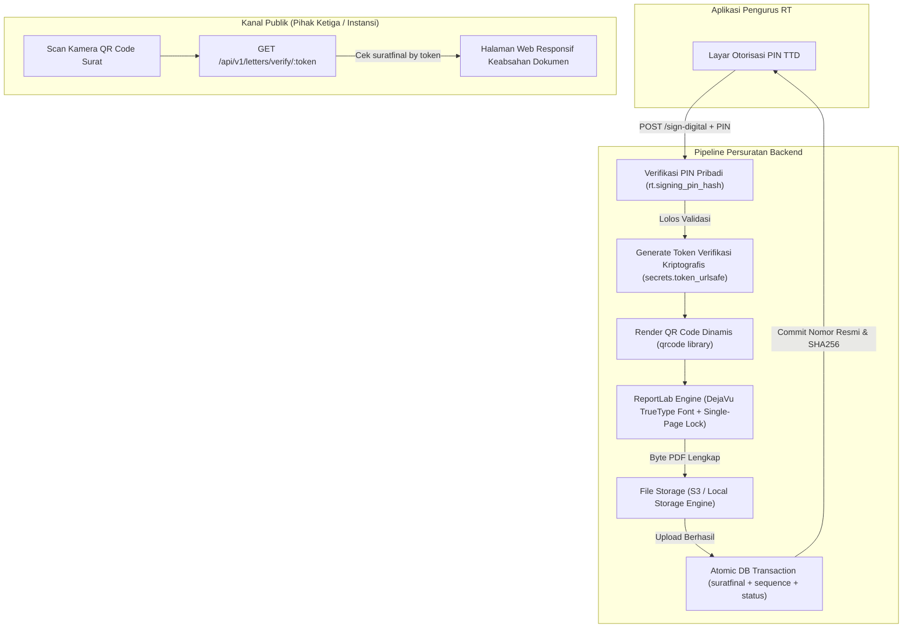
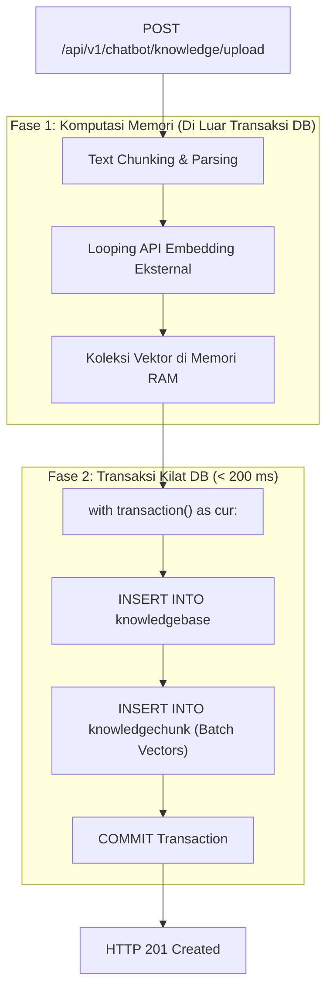
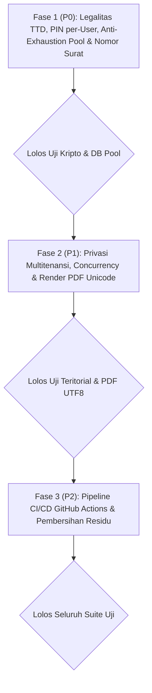

# Rencana Remediasi Komprehensif Keamanan, Integritas Hukum & Arsitektur RTConnect

* **Author:** Dhafin-dev
* **Status:** Approved & Implementation-Ready
* **Date:** 2026-11-25
* **Version:** 1.0.0

---

## Overview

Dokumen desain teknis dan perencanaan arsitektur ini merumuskan solusi teknis terstruktur untuk meremediasi 21 temuan audit komprehensif (7 *Critical Blockers*, 9 *Major Vulnerabilities*, dan 5 *Nits*) yang diidentifikasi pada laporan [PROJECT_HEALTH_AUDIT.md](../audit/PROJECT_HEALTH_AUDIT.md). Fokus utama remedi meliputi:
1. **Keabsahan Hukum Tanda Tangan Digital (UU ITE No. 11/2008 & PP 71/2019)**: Transformasi dari stempel gambar bitmap biasa menjadi dokumen PDF terverifikasi kriptografis lengkap dengan QR Code dinamis, hash SHA-256, dan rute verifikasi publik.
2. **Asas Non-Repudiasi & Keamanan Otentikasi**: Migrasi dari PIN TTD global bersama di environment ke hash bcrypt unik tersimpan per pengurus RT pada database.
3. **Resiliensi Transaksi & Anti-Starvation Database**: Pemindahan panggilan I/O jaringan eksternal ke luar blok transaksi database guna melindungi pool koneksi (`DB_POOL_MAX=5`) dari kelumpuhan (*pool exhaustion*).
4. **Integritas Nomor Surat & Konkurensi Status**: Atomisasi penomoran surat resmi dan penerapan *optimistic concurrency control* pada keputusan verifikasi RT.
5. **Kedaulatan Data & Tata Kelola Repositori**: Penegakan isolasi teritorial RT/RW (UU PDP No. 27/2022), penyelarasan total dokumentasi ke PostgreSQL (Supabase), serta implementasi otomasi CI/CD GitHub Actions.

---

## The Problem

Audit mendalam terhadap sistem RTConnect mengungkap celah kritis yang dapat membahayakan keabsahan hukum dokumen, keandalan server saat beban tinggi, dan privasi warga:

1. **Ilusi Tanda Tangan Digital & Risiko Pemalsuan**: Sistem saat ini menempelkan gambar tanda tangan transparan di atas kanvas PDF tanpa hash integritas. Token verifikasi acak (`qr_verification_token`) yang dibuat backend tidak pernah dirender ke kanvas PDF dan tidak ada endpoint verifikasi publik. Dokumen surat pengantar resmi rentan dipalsukan atau diubah isinya secara sepihak tanpa dapat diverifikasi keasliannya oleh instansi luar (Polsek, Kelurahan, Bank).
2. **Ketiadaan Tanggung Jawab Hukum Individu (Shared PIN)**: Seluruh pengurus RT memverifikasi otorisasi tanda tangan menggunakan satu nilai global `Config.RT_SIGNING_PIN_HASH` dari environment. Pengurus RT dapat saling menyangkal otorisasi surat ilegal (*loss of non-repudiation*), dan kebocoran satu PIN membahayakan seluruh klaster.
3. **Kerentanan Kelumpuhan Total Akibat Panggilan Eksternal**: Endpoint unggah dokumen basis pengetahuan menjalankan kalkulasi embedding OpenAI di dalam blok `with transaction() as cur:`. Menahan koneksi database pool (`DB_POOL_MAX=5`) selama puluhan detik memicu *connection pool starvation*, melumpuhkan login dan operasional warga di seluruh aplikasi.
4. **Skip Nomor Surat Resmi (Nomor Bocor)**: Penghitung nomor surat resmi di database dinaikkan dan di-commit sebelum proses render PDF ReportLab dan pengunggahan ke S3 selesai. Gangguan kecil pada jaringan storage menyebabkan nomor urut surat resmi terlewati permanen.
5. **Potensi Crash PDF & Ketiadaan Otomasi CI/CD**: Penggunaan font PostScript Latin-1 memicu crash HTTP 500 saat nama warga mengandung tanda baca khusus, dan tidak adanya workflow CI/CD di repositori membuat regresi kode tidak terdeteksi hingga aplikasi meledak di produksi.

---

## Goals

* **Penerbitan Surat Resmi yang Sah Secara Hukum**: Menghasilkan dokumen PDF ReportLab yang memuat QR Code verifikasi dinamis, menyimpan hash SHA-256 berkas final, dan menyediakan endpoint publik `GET /api/v1/letters/verify/<token>` yang dapat diakses siapa saja secara transparan.
* **Penegakan Non-Repudiasi Penuh**: Menyimpan `signing_pin_hash` terisolasi per individu Ketua RT/Pengurus di tabel database `public.rt`, lengkap dengan antarmuka ganti PIN mandiri.
* **Proteksi Pool Database (Zero-Starvation Invariant)**: Menjamin tidak ada panggilan HTTP eksternal atau operasi I/O lambat yang dieksekusi di dalam blok transaksi database aktif.
* **Integritas Penomoran Surat Resmi**: Menjamin nomor urut surat resmi bertambah secara atomik hanya jika berkas PDF berhasil dirender dan disimpan.
* **Kepatuhan Privasi Multitenansi (UU PDP No. 27/2022)**: Mengisolasi antrean dan akses berkas surat secara ketat berdasarkan wilayah yurisdiksi (`nomor_rt` dan `nomor_rw`).
* **Kekebalan Render Dokumen**: Menghilangkan crash `UnicodeEncodeError` pada ReportLab dengan mendaftarkan font TrueType Unicode dan mengunci tata letak strictly 1 lembar A4.
* **Otomasi Penjagaan Kualitas (CI/CD)**: Menerapkan pipeline GitHub Actions aktif yang menguji kompilasi Dart Flutter, linting, dan suite uji API Python pada setiap commit/PR.

## Non-Goals

* Mengintegrasikan sertifikat digital berbayar berbasis X.509 dari Balai Sertifikasi Elektronik (BSrE) / Peruri (arsitektur berfokus pada verifikasi kriptografis token publik dan SHA-256 hash internal RTConnect).
* Mengubah skema database menjadi multi-database terpisah (multitenansi diisolasi di level baris/query data `nomor_rt` dan `nomor_rw`).
* Menambahkan antrean pesan terdistribusi berat seperti Celery atau Redis (menjaga arsitektur tetap ramping sesuai prinsip Zoom-Out / Anti-YAGNI).

---

## Open Questions

* **Question 1**: Apakah domain publik untuk pemindaian QR Code verifikasi menggunakan domain backend langsung (misal: `https://api.rtconnect.id/verify/...`) atau domain aplikasi web portal warga (`https://rtconnect.id/verify/...`)?
  * *Keputusan Desain*: Menggunakan rute backend resmi yang menyajikan halaman HTML publik yang ramah mobile (*lightweight responsive verification card*).

---

## Critical User Journeys (CUJs)

### CUJ 1: Ketua RT Menandatangani Surat Secara Digital dengan PIN Pribadi
* **Given**: Surat warga telah disetujui, Ketua RT telah login ke akun pengurusnya, dan memiliki hash PIN tersendiri di database.
* **When**: Ketua RT menekan tombol "Tanda Tangani Surat", memasukkan PIN 6-digit pribadinya, dan menekan konfirmasi.
* **Then**: 
  1. Backend memverifikasi PIN terhadap `rt.signing_pin_hash` milik Ketua RT yang sedang login.
  2. Sistem merender PDF resmi yang memuat tanda tangan Ketua RT, tanda tangan digital warga, dan QR Code dinamis verifikasi.
  3. Berkas PDF disimpan ke storage (S3/lokal), nomor urut resmi dinaikkan secara atomik, dan hash SHA-256 dicatat ke tabel `suratfinal`.
  4. Warga menerima notifikasi bahwa surat telah selesai dan sah secara hukum.

### CUJ 2: Pihak Ketiga (Instansi Luar / Bank) Memverifikasi Keaslian Surat
* **Given**: Warga mencetak lembar surat fisik atau menunjukkan berkas PDF kepada petugas kelurahan/bank.
* **When**: Petugas memindai QR Code yang tercetak di pojok bawah surat menggunakan kamera ponsel.
* **Then**: 
  1. Peramban membuka URL `https://<domain>/api/v1/letters/verify/<token_verif>`.
  2. Sistem memvalidasi token terhadap tabel `suratfinal` dan mengembalikan halaman verifikasi resmi bertanda centang hijau "DOKUMEN RESMI & VALID".
  3. Halaman menampilkan metadata resmi: Nomor Surat, Jenis Surat, Inisial/Masking NIK Pemohon, Nama Ketua RT Penandatangan, Tanggal Pengesahan, dan Status Keaslian Dokumen tanpa membocorkan data rahasia warga.

### CUJ 3: Pengurus RT Mengunggah Dokumen Basis Pengetahuan Tanpa Mengunci Database
* **Given**: Pengurus RT mengunggah berkas pedoman lingkungan baru (misal: 25 potongan teks aturan) pada tab TanyaRT.
* **When**: Pengurus menekan tombol "Unggah & Proses Dokumen".
* **Then**: 
  1. Backend mem-parsing teks dan melakukan kalkulasi vektor embedding di memori di luar transaksi database.
  2. Setelah seluruh vektor siap, backend membuka transaksi kilat (< 200 ms) untuk menyimpan seluruh potongan ke tabel `knowledgechunk`.
  3. Koneksi database pool tidak pernah terkunci lama, dan warga lain tetap dapat melakukan login serta pengajuan surat tanpa hambatan.

### CUJ 4: Penanganan Peninjauan Surat Bersamaan (Anti-Race Condition)
* **Given**: Dua pengurus RT (misal: Ketua RT dan Sekretaris) membuka surat permohonan yang sama di layar masing-masing pada waktu bersamaan.
* **When**: Pengurus A menekan tombol "Tolak" (reject), dan sedetik kemudian Pengurus B menekan tombol "Setujui" (approve).
* **Then**: 
  1. Transaksi Pengurus A berhasil mengubah status surat dari `diajukan` menjadi `ditolak` (`rowcount = 1`).
  2. Permintaan Pengurus B ditolak secara aman oleh backend dengan respon HTTP 409 Conflict (`STATUS_ALREADY_MUTATED`), karena status surat bukan lagi `diajukan`.
  3. Aplikasi menampilkan pesan bahwa status surat telah diperbarui oleh pengurus lain, mencegah timpa-menimpa data yang membingungkan warga.

---

## Technical Plan (Architecture)

### 1. Arsitektur Tanda Tangan Digital & Verifikasi Dokumen Kriptografis



### 2. Arsitektur Unggah Dokumen RAG Bebas Kunci Transaksi (Anti-Starvation)



### 3. Migrasi Skema Database (PostgreSQL / Supabase DDL)

Untuk mendukung non-repudiasi, integritas verifikasi, dan revokasi otentikasi, migrasi skema database berikut akan diterapkan:

```sql
-- 1. Tambah PIN TTD per Pengurus RT dan versi token untuk revokasi instan
ALTER TABLE public.rt 
  ADD COLUMN IF NOT EXISTS signing_pin_hash VARCHAR(255),
  ADD COLUMN IF NOT EXISTS token_version INT NOT NULL DEFAULT 1;

ALTER TABLE public.warga
  ADD COLUMN IF NOT EXISTS token_version INT NOT NULL DEFAULT 1;

-- 2. Tambah kolom hash integritas PDF dan metadata verifikasi surat final
ALTER TABLE public.suratfinal
  ADD COLUMN IF NOT EXISTS pdf_hash VARCHAR(64),
  ADD COLUMN IF NOT EXISTS qr_verification_url TEXT;

-- 3. Indeks pencarian cepat untuk verifikasi token publik
CREATE UNIQUE INDEX IF NOT EXISTS ux_suratfinal_qr_token 
  ON public.suratfinal(qr_verification_token) 
  WHERE qr_verification_token IS NOT NULL;

-- 4. Indeks filter teritorial warga
CREATE INDEX IF NOT EXISTS idx_pengajuansurat_rt_rw 
  ON public.pengajuansurat(nomor_rt, nomor_rw, status);
```

### 4. Spesifikasi Antarmuka Verifikasi Publik

* **Endpoint Target**: `/api/v1/letters/verify/<string:token>`
* **Metode**: `GET`
* **Autentikasi**: Publik (Tidak memerlukan header `Authorization`)
* **Format Respon**:
  * Jika diakses dari peramban (`Accept: text/html`): Mengembalikan halaman HTML responsif elegan bertanda centang hijau/merah.
  * Jika diakses via API (`Accept: application/json`):
    ```json
    {
      "success": true,
      "message": "Dokumen resmi terverifikasi valid",
      "data": {
        "nomor_surat": "001/GSI-04/XI/2026",
        "jenis_surat": "Surat Pengantar SKCK",
        "pemohon_inisial": "A. D. (NIK: 3578***********)",
        "penandatangan": "Ahmad Dhafin (Ketua RT 04)",
        "tanggal_pengesahan": "2026-11-25 21:00:00",
        "status_dokumen": "SAH_TERDAFTAR",
        "pdf_hash": "e3b0c44298fc1c149afbf4c8996fb92427ae41e4649b934ca495991b7852b855"
      },
      "error": null
    }
    ```

---

## Risks & Mitigations

| Risiko / Modus Kegagalan | Dampak | Probabilitas | Rencana Mitigasi Teknis |
| :--- | :--- | :---: | :--- |
| **Pihak Ketiga Memalsukan PDF Hasil Ekstraksi** | Teks diubah, stempel tanda tangan disalahgunakan. | Sedang | **Verifikasi Hash & QR**: Surat wajib mencantumkan QR Code yang merujuk ke database resmi; verifikator dapat mencocokkan nomor surat dan SHA-256 dokumen. |
| **Pengurus RT Lupa PIN Pribadi** | Tidak dapat menandatangani surat warga. | Rendah | **Prosedur Reset PIN Aman**: Sediakan endpoint pemulihan PIN terautentikasi melalui verifikasi kata sandi akun login utama. |
| **Koneksi Storage Terputus di Tengah Penandatanganan** | Berkas PDF gagal diunggah ke S3/lokal. | Rendah | **Transaksional Atomik**: Nomor urut surat dan status surat tidak di-commit sebelum fungsi `store_bytes` mengembalikan konfirmasi sukses. |
| **Karakter Emoji / Unicode Warga pada Nama & Alamat** | ReportLab melempar `UnicodeEncodeError`. | Sedang | **Font TrueType UTF-8**: Mendaftarkan font DejaVu Sans / Liberation Serif dan menerapkan sanitasi transliterasi `unicodedata.normalize('NFKD')`. |
| **Lonjakan Pengajuan Bersamaan (Double Tapping)** | Permohonan surat kembar terbuat dobel. | Sedang | **Debounce & Idempotency Key**: Backend menolak permohonan dengan isi dan jenis yang sama dari warga yang sama dalam rentang 15 detik. |

---

## Alternatives Considered

### Matriks Evaluasi Alternatif Arsitektur

| Kriteria Evaluasi | Alternatif Terpilih: QR Token + Internal Hash SHA-256 | Alternatif A: Sertifikat Digital PAdES / BSrE | Alternatif B: Tetap Gambar Raster Biasa |
| :--- | :---: | :---: | :---: |
| **Keabsahan Verifikasi Instansi Luar** | **Sangat Baik (Bisa discan langsung)** | Terbaik (Standar Nasional) | **Nol (Bisa diedit/dipalsukan)** |
| **Biaya Implementasi & Sertifikasi** | **Rp 0 (Mandiri & Open)** | Mahal (Biaya Otoritas Sertifikasi) | Rp 0 |
| **Kompleksitas Infrastruktur** | **Ringan (Python `qrcode` + ReportLab)** | Berat (HSM / Token PKI eksternal) | Nol |
| **Perlindungan Non-Repudiasi** | **Kuat (PIN unik per user + Log Audit)** | Sangat Kuat | **Nol (PIN bersama di .env)** |

#### Alternatif A: Sertifikat Digital PAdES Resmi dari Otoritas Berbayar (BSrE / Peruri)
* *Kelebihan*: Memenuhi standar kriptografi PAdES nasional dengan sertifikat X.509 terdaftar Kominfo.
* *Kekurangan*: Membutuhkan integrasi API institusi berbayar, verifikasi biometrik KTP rumit, dan biaya operasional per tanda tangan yang tidak realistis untuk kas rukun tetangga.
* *Alasan Penolakan*: Alternatif QR Code dinamis berbasis token bertanda tangan internal + hash SHA-256 dokumen sudah memberikan jaminan integritas anti-pemalsuan dan verifikasi instan bagi instansi publik tanpa beban biaya variabel.

#### Alternatif B: Mempertahankan Stempel Gambar Raster Tanpa QR
* *Kelebihan*: Tidak memerlukan penulisan kode baru pada modul PDF.
* *Kekurangan*: Melanggar standar hukum UU ITE Pasal 11 karena dokumen sama sekali tidak memiliki mekanisme pendeteksian manipulasi teks.
* *Alasan Penolakan*: Audit kesehatan membuktikan bahwa skema gambar biasa adalah celah legalitas fatal yang membahayakan warga jika surat ditolak oleh instansi resmi.

---

## Non-Functional Requirements (NFR)

* **Keamanan & Kepatuhan Hukum**:
  - Seluruh verifikasi tanda tangan digital wajib merujuk ke akun terdaftar (`rt.signing_pin_hash`).
  - Dokumen PDF wajib memuat QR Code verifikasi beresolusi tajam (minimal 150 DPI).
  - Data pribadi (NIK, No. KK) pada halaman verifikasi publik wajib disamarkan (masking).
* **Kinerja & Skalabilitas Transaksi**:
  - Waktu respons pembubuhan tanda tangan dan render PDF maksimal `3.0 detik`.
  - Waktu checkout koneksi pool database dibatasi maksimal `3.0 detik` (mencegah *thread hanging*).
  - Waktu respons halaman verifikasi publik maksimal `500 ms`.
* **Kompabilitas & Portabilitas**:
  - Seluruh perubahan skema bersifat backward-compatible (kolom baru memiliki default atau nullable).
  - Font TrueType di-bundle lokal di repositori agar independen dari ketersediaan font di OS host.

---

## Detailed Implementation Plan

Rencana implementasi dibagi menjadi 3 fase bertahap dengan *checkpoint* verifikasi yang ketat:



---

### Fase 1: Legalitas TTD Digital, PIN Unik Pengurus, & Proteksi Database Pool (Prioritas P0)

#### Berkas yang Dimodifikasi / Dibuat:
1. **`backend/database/schema.sql` & Migration Patch (Modify & Create)**
   - Tambahkan kolom `signing_pin_hash` dan `token_version` pada `public.rt`.
   - Tambahkan kolom `pdf_hash` pada `public.suratfinal`.
   - Buat skrip migrasi teruji `backend/database/migrations/20261125_remediasi_p0.py`.
2. **`backend/services/pin_guard_service.py` (Modify)**
   - Ganti pembandingan PIN dari `Config.RT_SIGNING_PIN_HASH` menjadi `user.get('signing_pin_hash')`.
   - Sediakan fungsi `set_user_signing_pin(user_id, new_pin)`.
3. **`backend/services/pdf_service.py` (Modify)**
   - Tambahkan integrasi pustaka `qrcode` untuk membuat *flowable image* QR Code pada kanvas ReportLab.
   - Letakkan QR Code di samping kotak tanda tangan Ketua RT.
   - Hitung hash SHA-256 dari `BytesIO` PDF final dan kembalikan tuple `(pdf_bytes, sha256_hash)`.
4. **`backend/routes/letter_routes.py` (Modify)**
   - Buat rute verifikasi publik: `GET /api/v1/letters/verify/<string:token>`.
   - Di dalam `sign_digital()`, simpan `pdf_hash` ke `suratfinal` dan atomisasi kenaikan nomor surat resmi.
5. **`backend/routes/chatbot_routes.py` (Modify)**
   - Pindahkan `generate_embedding()` ke luar blok `with transaction() as cur:`.
* **Checkpoint Fase 1**: Uji coba penandatanganan surat menghasilkan PDF ber-QR Code yang bisa di-scan, nomor urut tidak loncat saat error, dan simulasi unggah dokumen tidak menahan koneksi database.

---

### Fase 2: Privasi Multitenansi, Concurrency Lock, & Rendering PDF Unicode (Prioritas P1)

#### Berkas yang Dimodifikasi:
1. **`backend/routes/letter_routes.py` (Modify)**
   - Tambahkan filter teritorial pada `get_incoming_queue` dan `get_application_detail`:
     `WHERE (p.nomor_rt = %s AND p.nomor_rw = %s) OR user_role = 'admin'`.
   - Terapkan *optimistic locking* pada `submit_decision`:
     `UPDATE pengajuansurat SET status = %s WHERE pengajuan_id = %s AND status = 'diajukan'`.
   - Ambil tanda tangan digital warga pemohon dan letakkan pada kolom "Yang bersangkutan" di PDF.
   - Tambahkan mekanisme debounce permohonan surat kembar (anti-double tapping).
2. **`backend/services/pdf_service.py` (Modify)**
   - Daftarkan font TrueType Unicode (DejaVu / Liberation) untuk menggantikan PostScript Type 1.
   - Kunci batasan tinggi flowable teks keperluan agar dokumen konsisten 1 lembar A4.
3. **`backend/middleware/auth_middleware.py` (Modify)**
   - Hapus pembacaan token dari `request.args.get('token')` untuk rute API biasa.
   - Periksa `token_version` terhadap database untuk revokasi instan.
* **Checkpoint Fase 2**: Akses akun RT 04 ke data warga RT 01 terblokir 403; karakter emoji/smart-quotes pada nama warga tidak lagi memicu error 500; tanda tangan warga tampil di lembar PDF.

---

### Fase 3: Pipeline CI/CD GitHub Actions, Pembersihan Residu & Standarisasi (Prioritas P2)

#### Berkas yang Dimodifikasi / Dibuat:
1. **`.github/workflows/ci.yml` (Create)**
   - Setup GitHub Actions untuk menjalankan `flutter analyze` dan `flutter test`.
   - Menjalankan `python -m py_compile` dan `backend/test_tanyart_full.py`.
2. **`AGENTS.md` & `DEPLOYMENT.md` (Modify)**
   - Hapus seluruh instruksi usang MySQL dan rujukan file demo yang tidak ada.
   - Standarisasikan seluruh dokumentasi pada arsitektur PostgreSQL (Supabase).
3. **`backend/app.py` (Modify)**
   - Daftarkan global error handler untuk `HTTPException` agar selalu merender JSON envelope `{success, message, data, error}`.
   - Selaraskan output `GET /api` agar mematuhi kontrak envelope standar.
* **Checkpoint Fase 3**: Commit baru memicu workflow GitHub Actions hijau (*green build*), dan dokumentasi repositori bebas dari pertentangan data.

---

## Target Files to Create/Modify

### Berkas yang Dibuat (Create):
1. `backend/database/migrations/20261125_remediasi_p0.sql` (Skrip DDL migrasi kolom PIN dan hash PDF).
2. `backend/templates/verification_page.html` (Template web responsif verifikasi publik surat).
3. `.github/workflows/ci.yml` (Workflow otomasi integrasi berkesinambungan).

### Berkas yang Dimodifikasi (Modify):
1. `backend/services/pdf_service.py` (Render QR Code, font TrueType, penempatan TTD warga, SHA-256 hash).
2. `backend/routes/letter_routes.py` (Endpoint verifikasi publik, optimistic lock, atomisasi nomor resmi).
3. `backend/services/pin_guard_service.py` (Validasi PIN per-user basis database).
4. `backend/routes/chatbot_routes.py` (Pemindahan embedding ke luar transaksi DB).
5. `backend/middleware/auth_middleware.py` (Pembersihan token query URL & verifikasi `token_version`).
6. `backend/app.py` (JSON error handler seragam untuk seluruh HTTP Exception).
7. `AGENTS.md` & `DEPLOYMENT.md` (Pembersihan residu MySQL dan sinkronisasi PostgreSQL).

---

## Verification Plan

Pengujian terotomasi wajib dijalankan secara konsisten dari root repositori:

```bash
# 1. Uji Kompilasi Sintaks Seluruh Modul Backend
backend/.venv/Scripts/python.exe -m py_compile backend/config.py backend/app.py backend/services/pdf_service.py backend/services/pin_guard_service.py backend/routes/letter_routes.py backend/routes/chatbot_routes.py

# 2. Uji Verifikasi Tanda Tangan Digital & Render QR Code
backend/.venv/Scripts/python.exe -c "from services.pdf_service import generate_official_letter_pdf_bytes; print('PDF Engine OK')"

# 3. Uji Suite Regresi TanyaRT & Isolasi Keamanan
backend/.venv/Scripts/python.exe backend/test_tanyart_full.py

# 4. Uji Pengukuran Latensi Operasional
backend/.venv/Scripts/python.exe backend/ukur_latensi_lengkap.py
```

*Kriteria Kelulusan:* Seluruh perintah berakhir sukses (exit code 0), dokumen PDF hasil uji memuat QR Code yang dapat dibaca, dan endpoint publik verifikasi merespons dengan HTTP 200.

---

*Drafted & Planned with Google EGM (Elephant-Goldfish Model)*
